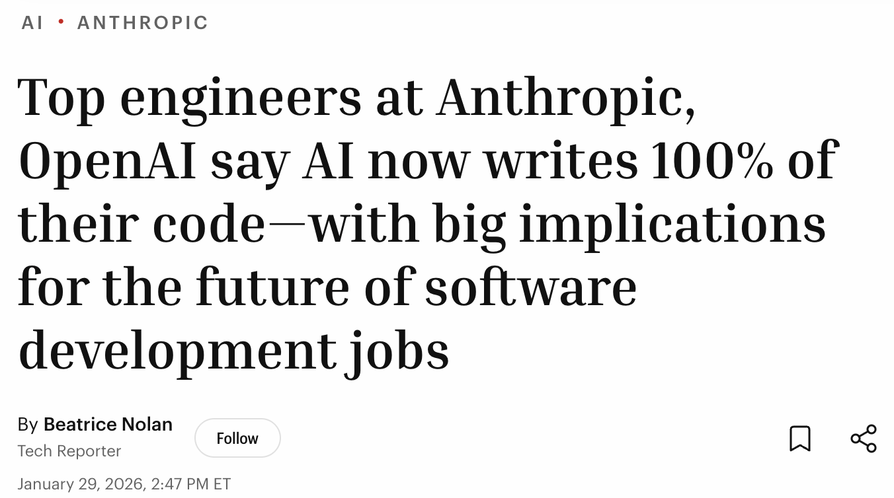
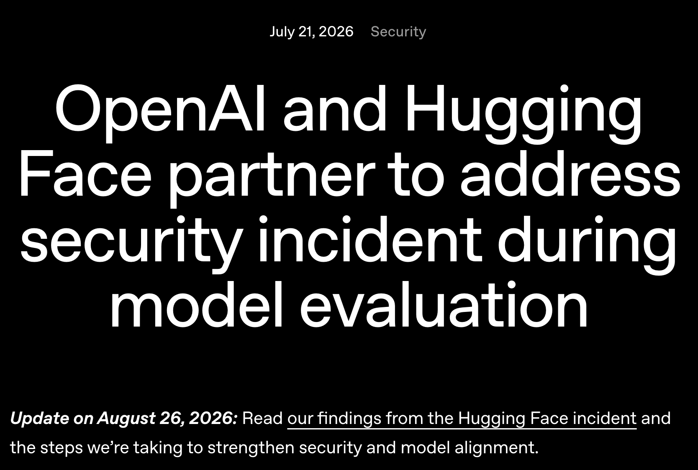
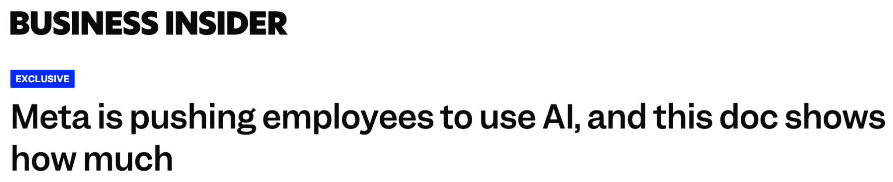
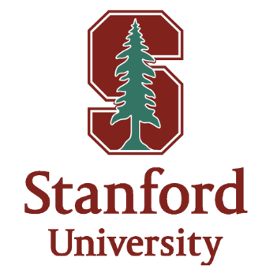

# 《现代软件开发者》第 1 讲：导论与编码 Agent

> **非官方中文翻译**，仅供学习参考，不代表原作者或斯坦福大学。
> 源幻灯片：[`0922-intro-and-coding-agent en.pptx`](./0922-intro-and-coding-agent%20en.pptx)
> 抓取日期：2026-10-22
> 说明：按原 pptx 逐页全文翻译，保留原始 URL、代码、专名与时间戳；内嵌图片提取到 [`images/0922/`](images/0922/)，图中英文在图片下方给出中文对照。代码与命令保持原文，不执行。

## 第 1 页：现代软件开发者

**现代软件开发者**

CS146S

斯坦福大学，2026 年秋季

Mihail Eric

themodernsoftware.dev

## 第 2 页：2026 年世界现状

**2026 年世界现状**

图中文字中文对照：Business Insider（商业内幕）科技版；标题大意：“Anthropic 与 OpenAI 的顶尖工程师表示，AI 现在编写了他们 100% 的代码——这对软件开发岗位的未来影响重大。”作者 Beatrice Nolan，Tech Reporter（科技记者），2026 年 1 月 29 日下午 2:47（美国东部时间）。

图中文字中文对照：BUSINESS INSIDER（商业内幕）；CULTURE（文化版）；标题大意：“这种 90 年代的迷幻风潮，如今成了 Z 世代的最新痴迷：Hacky Sack（沙包/踢毽子玩具）。”

图中文字中文对照：2026 年 7 月 21 日；Security（安全）；标题大意：“OpenAI 与 Hugging Face 合作处理模型评估期间的安全事件。”文末更新：“2026 年 8 月 26 日更新：阅读我们关于 Hugging Face 事件的调查结果，以及我们为加强安全和模型对齐所采取的措施。”

图中文字中文对照：BUSINESS INSIDER（商业内幕）；EXCLUSIVE（独家）；标题大意：“Meta 正在推动员工使用 AI，这份文件显示了推动力度有多大。”

> **演讲者备注**：随着 Claude Opus 4.5 在 2025 年 12 月初发布，编码 agent 的能力大幅跃升。他们在 2025 年就做出了预测，而现在基本已经补上了差距。编码助手（coding assistant）正在转向真正的 agentic 工作。在工作队伍中使用 AI 已经不再是可选项。Agent 变得太强，也带来了新的挑战。踢沙包（hacky sack）这种潮流又回来了。

## 第 3 页：这对你意味着什么

**这对你意味着什么**

- 全行业更广泛的 AI 采用，意味着公司需要你。
  - 成为“AI 原生”（AI-native）现在是新的目标。
- 但是……下限更高了。
- 软件开发者如今的生产力处于历史最高水平，因此外界期望也水涨船高。
- 关注整体性的系统级思维、架构与抽象。
  - 再结合 AI 优先的开发实践，你将变得不可替代。

> **演讲者备注**：去年的趋势是取消初级岗位，理由是“AI 会取代这些岗位”；现在团队则希望提升技能、完成转型，让自己更加 AI 原生。你们这一代人是在这个时代成长起来的。很多人的计算机科学之路，刚开始于 ChatGPT 问世的时候。许多雇主已经采用了“一刀切”的政策，比如不再招聘 L3/L4；或者至少要求达到 L5 及以上的水准。今天学习计算机科学的学生，可以比我当年学习时强一个数量级。借助 AI 编码，工程师能以空前的速度掌握技术栈和工具。生逢其时！如果你能从系统层面思考、理解业务背景、设计有韧性的架构与抽象，AI 就会像给后背装上火箭一样提升你的生产力。

## 第 4 页：现代软件开发者

**现代软件开发者**

（本页为章节过渡页，除标题与站点标识外没有其他正文。）

> **演讲者备注**：这就引出了我们这门课……

## 第 5 页：这门课讲的是原则，不是工具

**这门课讲的是原则，不是工具。**

> **演讲者备注**：这是一门面向相当有经验的工程师的课程，目标是让他们真正成为 10x 工程师。

## 第 6 页：一页讲完 10 周

**一页讲完 10 周**

（原幻灯片此页除标题和底部的红色装饰条外没有正文内容；pptx 中也没有对应的图片或表格，属于空白的章节页。）

## 第 7 页：核心结论

**核心结论**

- **人与 Agent 工程（Human-agent engineering）**
  - 专注于那些尚未被 AI 系统取代的技能。
  - 业务与产品理解。
  - 成为技术架构师——培养对软件系统的良好品味。
  - 沟通至关重要。
- **LLM 的上限取决于你**
  - 好的上下文带来好的代码。
  - 如果你自己都理解不了代码库，LLM 也理解不了。
  - 防止“AI 垃圾代码”（AI slop）。
- **大胆实验。**

## 第 8 页：课程安排

**课程安排**

**讲师（你们好！）**

- 斯坦福大学本科/研究生。
- Monaco 的 AI 负责人；Monaco 是一家总部位于旧金山的销售领域创业公司。
- 为数十家公司担任 AI 顾问，覆盖从种子期创业公司到上市企业。
- 在 Amazon Alexa 构建了最早的一批 LLM。
- 创办并出售了一家机器学习教育创业公司。
- 创办了一家由 YC 支持的 AI 编码公司。

**两位很棒的课程助教（CA）**

- Isaac Kan
- Vijay Daita

图中文字中文对照：Alexa（亚马逊 Alexa）；Stanford University（斯坦福大学）；CITADEL Securities（城堡证券）。其余为无文字或文字不可辨识的机构/公司徽标。

## 第 9 页：课程安排

**课程安排**

<https://themodernsoftware.dev>

**讲座**

- 周二/周四 17:30–18:20。

**交付成果**

- 6 次作业（每周 1 次），用于练习讲座内容。
  - <https://github.com/mihail911/modern-software-dev-assignments>
- 向开源（OSS）仓库提交 3–4 次贡献。
- 1 个开放式期末项目，用来实践课程中讲授的 AI 编码原则。

**评分**

- 项目/作业/开源贡献/课堂参与的比例为 50/15/30/5。

> **演讲者备注**：所有讲座材料都在课程官网。补充阅读也会放在那里。作业链接也在那里。这门课会很难。

## 第 10 页：课程安排

**课程安排**

**开源合作伙伴（OSS Partners）**

- 15 个顶尖的 AI 原生开源项目，包括 Vercel、Warp、Marimo、Milvus、Pi、CrewAI、Browserbase、HeyGen、CopilotKit、Semgrep、OpenHands、Cmux、Arize、Sloth、Anyscale。

**客座讲座**

- 当今顶尖 AI 开发者团队的创始人与工程高管（Claude Code、Devin、Replit、Factory 等的创造者）。
- 融资额达数十亿美元，估值达数百亿美元。
- 不要错过这些讲座！

> **演讲者备注**：开源合作伙伴作业的目的，是让你获得在复杂代码库中工作和贡献的实践经验。

## 第 11 页：如何用 200 行代码构建 Claude Code

**如何用 200 行代码构建 Claude Code**

> **演讲者备注**：为了更好地理解如何用编码 agent 开发，我们需要理解 agent 是如何构建的。这将是本周的重点。

## 第 12 页：就这么简单

**就这么简单。**

图中文字中文对照：这些图标表示用户、编码 agent 客户端（Windsurf、Cursor、Claude）和底层 LLM。其中一张图标上写有 **LLM**（大语言模型）；其余图标没有可辨识的英文文字。

> **演讲者备注**：用户与编码 agent 客户端（Windsurf、Cursor、Claude Code）交互，并围绕底层 LLM 运行一个循环。有时 LLM 会发出工具调用，客户端在 LLM 之外执行这些调用。

## 第 13 页：步骤

**步骤**

- 在终端中读取输入，并不断追加到对话中。
- 告诉 LLM 有哪些工具可用。
  - 它会在合适的时机请求使用工具。
  - 你在 LLM 之外执行工具，并把结果返回。
  - 工具：
    - `Read_file`
    - `List_dir`
    - `Edit_file`

## 第 14 页：让我们从零构建一个编码 agent！

**让我们从零构建一个编码 agent！**

图中说明：一张攀岩者照片（现场配图）；图中没有文字。

## 第 15 页：有问题吗？

**有问题吗？**
