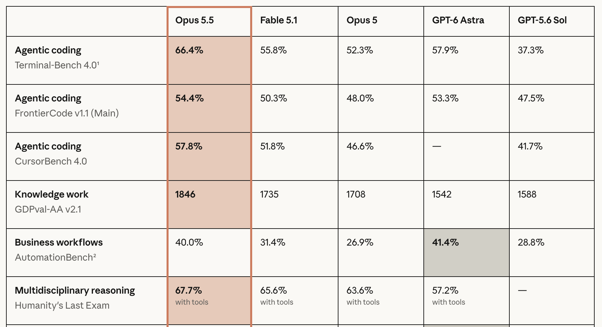
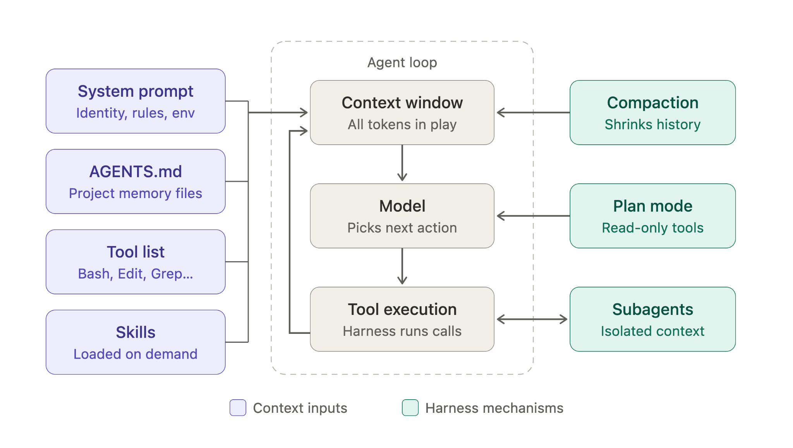

# 《现代软件开发者》第 2 讲：现代编码 Agent 的解剖结构

> **非官方中文翻译**，仅供学习参考，不代表原作者或斯坦福大学。
> 源幻灯片：[`0924-agent-harness en.pptx`](./0924-agent-harness%20en.pptx)
> 抓取日期：2026-10-22
> 说明：按原 pptx 逐页全文翻译，保留原始 URL、代码、专名与时间戳；内嵌图片提取到 [`images/0924/`](images/0924/)，图中英文在图片下方给出中文对照。代码与命令保持原文，不执行。

## 第 1 页：现代软件开发者

**现代软件开发者**

CS146S

斯坦福大学，2026 年秋季

Mihail Eric

themodernsoftware.dev

## 第 2 页：课程事务

**课程事务**

- 期末项目规格已经发布。
  - 允许额外增加 1 名团队成员（除此之外还可以使用一群编码 agent）。
- 不同编码 agent 提供商的额度：
  - Claude
  - Factory
  - X.AI
  - Devin
- 下周会公布开源贡献的更多细节。
- 课程申请的最终截止日期是 9/27。

## 第 3 页：现代编码 Agent 的解剖结构

**现代编码 Agent 的解剖结构**

> **演讲者备注**：这就引出了我们这门课……

## 第 4 页：回顾

**回顾**

图中文字中文对照：这些图标表示用户、编码 agent 客户端（Windsurf、Cursor、Claude）和底层 LLM。其中一张图标上写有 **LLM**（大语言模型）；其余图标没有可辨识的英文文字。

> **演讲者备注**：用户与编码 agent 客户端（Windsurf、Cursor、Claude Code）交互，并围绕底层 LLM 运行一个循环。有时 LLM 会发出工具调用，客户端在 LLM 之外执行这些调用。

## 第 5 页：进入最先进的编码 agent

**进入最先进的编码 agent**

图中文字中文对照：这是一张编码 agent 基准测试排行榜。列标题为 Opus 5.5、Fable 5.1、Opus 5、GPT-6 Astra、GPT-5.6 Sol。行标题与中文含义如下：

| 类别 / 基准 | 中文含义 | Opus 5.5 | Fable 5.1 | Opus 5 | GPT-6 Astra | GPT-5.6 Sol |
|---|---|---:|---:|---:|---:|---:|
| Agentic coding — Terminal-Bench 4.0 | 智能体编码：终端任务基准 4.0 | 66.4% | 55.8% | 52.3% | 57.9% | 37.3% |
| Agentic coding — FrontierCode v1.1 (Main) | 智能体编码：前沿代码基准 v1.1（主榜） | 54.4% | 50.3% | 48.0% | 53.3% | 47.5% |
| Agentic coding — CursorBench 4.0 | 智能体编码：Cursor 基准 4.0 | 57.8% | 51.8% | 46.6% | 58.2% | 41.7% |
| Knowledge work — GDPval-AA v2.1 | 知识工作：GDPval-AA v2.1 | 1846 | 1735 | 1708 | 1542 | 1588 |
| Business workflows — AutomationBench | 业务流程：自动化基准 | 40.0% | 31.4% | 26.9% | 41.4% | 28.8% |
| Multidisciplinary reasoning — Humanity's Last Exam (with tools) | 多学科推理：人类最后考试（使用工具） | 67.7% | 65.6% | 63.6% | 57.2% | 49.6% |

> **演讲者备注**：用户与编码 agent 客户端（Windsurf、Cursor、Claude Code）交互，并围绕底层 LLM 运行一个循环。有时 LLM 会发出工具调用，客户端在 LLM 之外执行这些调用。

## 第 6 页：现代编码 harness 更复杂

**现代编码 harness 更复杂**

- Harness 设计是编码 agent 中最重要的问题之一。
- 组成部分：
  - 系统提示词（System prompt）
  - 自定义配置文件（AGENTS.md 等）
  - 工具列表（Tool list）
  - 计划模式（Plan mode）
  - 子 agent（Subagents）
  - 技能（Skills）
  - 钩子（Hooks）
  - 压缩（Compaction）

> **演讲者备注**：这些是 Claude 这类 agent 中的一些组成部分。

## 第 7 页：Claude Code Harness 架构

图中文字中文对照与结构说明：

- 顶部左侧 **Context inputs（上下文输入）**，顶部右侧 **Harness mechanisms（Harness 机制）**。
- 左侧一列：
  - **System prompt（系统提示词）**——Identity, rules, env（身份、规则、环境）。
  - **AGENTS.md**——Project memory files（项目记忆文件）。
  - **Tool list（工具列表）**——Bash, Edit, Grep...（Bash、编辑、Grep 等）。
  - **Skills（技能）**——Loaded on demand（按需加载）。
- 中央 **Agent loop（Agent 循环）**：
  - **Context window（上下文窗口）**——All tokens in play（所有参与推理的 token）。
  - **Model（模型）**——Picks next action（选择下一步动作）。
  - **Tool execution（工具执行）**——Harness runs calls（由 harness 执行调用）。
- 右侧：
  - **Compaction（压缩）**——Shrinks history（缩减历史）。
  - **Plan mode（计划模式）**——Read-only tools（只读工具）。
  - **Subagents（子 agent）**——Isolated context（隔离的上下文）。

## 第 8 页：工具列表

**工具列表**

- 能力精简但强大，覆盖搜索、shell 命令和 agent 任务。
- 以 Claude 为例，内置约 40 个工具。
- MCP 工具同样可用，并会加载到上下文中。
- 工具的描述、名称和完整签名都属于提示词的一部分。

## 第 9 页：系统提示词

**系统提示词**

- 系统层面的蓝图。
- 定义：
  - Harness / 行为方式
  - 防护边界（Guardrails）
  - 环境（例如：系统是什么、我们身处何处）

## 第 10 页：Agent 配置文件

**Agent 配置文件**

- 用户级的 agent 自定义配置，例如 `CLAUDE.md` / `AGENTS.md`。
- 优先级高于其他命令。

## 第 11 页：计划模式

**计划模式**

- 一个显式工具，提示 agent 为某项变更编写规格（spec）。
- 可以与用户进一步问答，以澄清需求。

## 第 12 页：技能

**技能（Skills）**

- 描述 agent 要执行的一套书面流程。
- 是带有工具调用和/或本地脚本调用的提示词。
- 可以由 agent 主动调用，也可以被显式调用。

## 第 13 页：子 agent

**子 agent（Subagents）**

- 通过显式的工具调用启动。
- 在会话内获得全新上下文，并带有自定义系统提示词。
- 允许并行化（但 token 成本会上升）。
- 最终结果回传给父 agent。

## 第 14 页：钩子

**钩子（Hooks）**

- 在 harness 生命周期的不同节点插入的提示词或代码片段。
- 当需要做一些前处理/后处理时尤其有用。
- 最佳实践稍后讨论。

## 第 15 页：压缩

**压缩（Compaction）**

- 当上下文即将超限时，对 agent 运行中的关键点生成一份合并摘要。
- 用摘要替换现有历史。
- 可以手动或自动触发。
- 可能有损，因此你可能需要改用自己实现的 compaction。

## 第 16 页：有效 Harness 的原则

**有效 Harness 的原则**

- **简单（Simplicity）**
  - 更少但更强大的工具更受青睐（SQL、Bash 等）。
- **留意上下文窗口**——避开“变笨区”（dumb zone），小心工具膨胀。
  - 关于最优上下文工程，后面会讲更多。
- **提示词的内容和长度会演化**——让它们易于调整。

## 第 17 页：有问题吗？

**有问题吗？**
