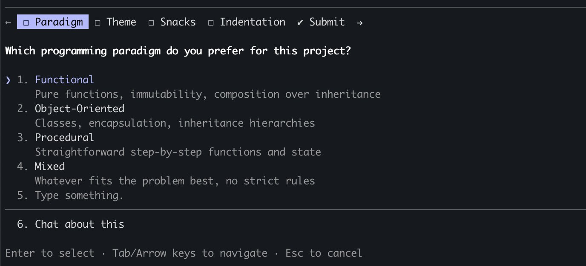
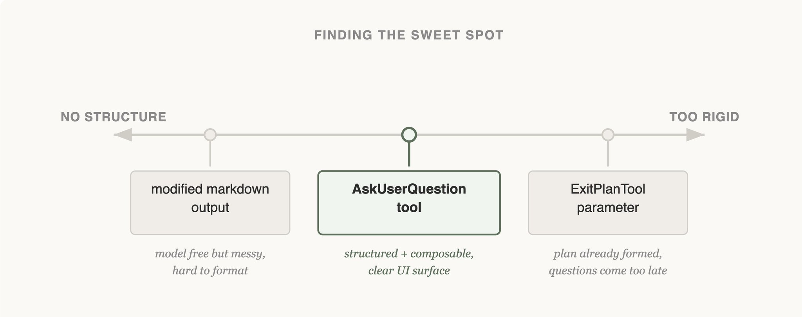
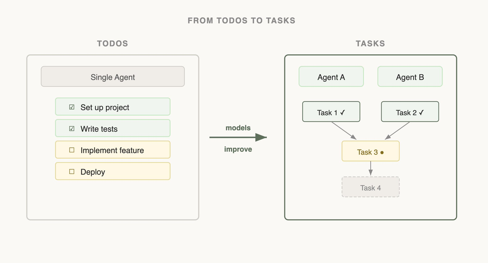

# 构建 Claude Code 的经验：像 Agent 一样观察

> 作者：Thariq（[@trq212](https://x.com/trq212)），Anthropic Claude Code 团队
> 原文：<https://x.com/trq212/status/2027463795355095314>（X Article，2026-02-27）
> 英文原文：[Seeing like an Agent en.md](./Seeing%20like%20an%20Agent%20en.md)
> 译文说明：术语保留英文（tool calling、Skills、progressive disclosure 等），便于对照原文与官方文档。

构建一个 agent harness 最难的部分之一，是构造它的动作空间（action space）。

Claude 通过 Tool Calling 行动，但在 Claude API 里，工具可以用多种原语构造：比如 [bash](https://platform.claude.com/docs/en/agents-and-tools/tool-use/bash-tool)、[skills](https://code.claude.com/docs/en/skills)，以及最近加入的 [code execution](https://platform.claude.com/docs/en/agents-and-tools/tool-use/code-execution-tool)（关于 Claude API 上的 programmatic tool calling，可以读 [@RLanceMartin 的新文章](https://x.com/RLanceMartin/status/2027450018513490419)）。

有这么多选项，你该怎么设计 agent 的工具？只给它一个工具，比如 code execution 或 bash？还是给它 50 个工具，每个用例一个？

为了站在模型的视角思考，我喜欢想象自己拿到一道很难的数学题：为了解出它，我想要什么工具？这取决于我自己的技能水平。

纸笔是最低配，但你会被手工计算拖住。计算器更好，但你得会用那些高级功能。最快最强的选择是计算机，但你得会用它写代码、跑代码。

这是一个设计 agent 的有用框架：你希望给它形状贴合它自身能力的工具。可你怎么知道那些能力是什么？去观察、读它的输出、做实验。你要学会像 agent 一样观察（see like an agent）。

下面是我们构建 Claude Code 时，通过观察 Claude 得到的一些经验。

## 改进 elicitation 与 AskUserQuestion 工具

做 AskUserQuestion 工具时，我们的目标是提升 Claude 提问的能力（通常称为 elicitation）。

Claude 当然可以用纯文本提问，但我们发现回答这些问题会不必要地耗时。怎样降低这种摩擦、提高用户与 Claude 之间的沟通带宽？

### 尝试 1 —— 修改 ExitPlanTool

我们最先试的是给 ExitPlanTool 加一个参数，让它在给出 plan 的同时附带一个 questions 数组。这是最容易实现的改法，但它让 Claude 困惑：我们同时在要一份 plan，又在要一组关于这份 plan 的问题。如果用户的回答与 plan 冲突怎么办？Claude 是否要调用两次 ExitPlanTool？我们需要换一种做法。

（关于我们为什么做 ExitPlanTool，可以读[这篇关于 prompt caching 的文章](https://x.com/trq212/status/2024574133011673516)）

### 尝试 2 —— 改变输出格式

接着我们修改 Claude 的输出指令，让它输出一种略微定制的 markdown 格式来提问。例如要求它输出一组项目符号问题，括号里放备选项。然后我们解析这个格式，渲染成给用户的 UI。

这是我们能做的最通用的改法，Claude 看起来也还算能输出，但并不可靠：它会多写几句话、漏掉选项，或者干脆换成另一种格式。

### 尝试 3 —— AskUserQuestion 工具

最终我们落到了一个专用工具：Claude 可以在任意时刻调用它，但在 plan mode 下会被特别提示去调用。工具触发时，我们弹出一个 modal 展示问题，并阻塞 agent 循环，直到用户作答。

这个工具让我们可以要求 Claude 输出结构化结果，也帮助我们确保它给出多个选项。它还让用户能以可组合的方式使用这个能力，例如在 [Agent SDK](https://platform.claude.com/docs/en/agent-sdk/overview) 里调用，或在 skills 里引用它。

最重要的是，Claude 看起来喜欢调用这个工具，输出效果也不错。毕竟，设计得再好的工具，如果 Claude 不理解怎么调用，也是白搭。

这是 Claude Code 里 elicitation 的最终形态吗？我们不确定。下一个例子会说明：对某个模型有效的做法，对另一个模型未必最好。

## 随能力演进 —— 从 Todos 到 Tasks

Claude Code 刚发布时，我们意识到模型需要一个 Todo 列表，以免偏离正轨。Todo 可以在开始时写好，模型完成一项就勾掉一项。为此我们给了 Claude TodoWrite 工具，它可以写入或更新 Todo，并展示给用户。

但即便如此，我们仍经常看到 Claude 忘记自己要做什么。为此我们每隔 5 轮插入一次 system reminder，提醒它目标是什么。

然而随着模型变强，它们不仅不需要被提醒 Todo 列表，反而会觉得这是一种限制。被反复提醒 todo 列表，会让 Claude 以为必须严格遵守列表，而不是去修改它。我们还看到 Opus 4.5 在使用 subagent 方面强了很多，但多个 subagent 如何在一个共享 Todo 列表上协作？

看到这些，我们用 [Task 工具](https://x.com/trq212/status/2014480496013803643)取代了 TodoWrite（关于 Tasks 可以读那篇）。Todo 的重点是让模型保持在轨道上，而 Task 的重点是帮助多个 agent 彼此沟通。Task 可以带依赖关系、在 subagent 之间共享更新，模型还可以修改和删除它们。

随着模型能力提升，模型曾经需要的工具，如今可能正在约束它们。持续重新审视「到底需要哪些工具」的旧假设很重要。这也是为什么最好只支持一小批能力画像相近的模型。

## 设计搜索接口

对 Claude 来说特别重要的一类工具，是能让它自行构建上下文的搜索工具。

Claude Code 最早发布时，我们用 RAG 向量数据库为 Claude 找上下文。RAG 强大且快，但它需要索引与配置，在很多不同环境里可能很脆弱。更重要的是，这份上下文是「被喂给」Claude 的，而不是 Claude 自己找的。

但如果 Claude 能在网上搜索，为什么不能在代码库里搜索？给它一个 Grep 工具，我们就能让它自己搜文件、自己构建上下文。

我们反复看到这样一个模式：Claude 越聪明，只要给它合适的工具，它构建上下文的能力就越强。

引入 [Agent Skills](https://agentskills.io/home) 时，我们把 progressive disclosure（渐进式披露）这个概念正式化：agent 可以通过探索，逐步发现相关上下文。

Claude 可以读 skill 文件，而这些文件又可以引用其他文件，模型可以递归读取。事实上，skills 的一个常见用法就是给 Claude 增加搜索能力，例如教它如何使用某个 API 或查询数据库。

一年时间里，Claude 从基本无法自行构建上下文，进步到能跨多层文件做嵌套搜索，精确找到它需要的上下文。

现在，progressive disclosure 已经是我们「不新增工具就增加新功能」的常用技术。

## Progressive Disclosure —— Claude Code Guide Agent

Claude Code 目前约有 20 个工具，我们经常自问是否全都需要。新增工具的门槛很高，因为每加一个，就给模型多一个需要权衡的选项。

例如，我们注意到 Claude 对「如何使用 Claude Code」了解不够。如果你问它怎么添加 MCP、某个 slash command 是做什么的，它答不上来。

我们本可以把这些信息全塞进 system prompt，但用户很少问这类问题，这么做只会造成上下文腐化（context rot），干扰 Claude Code 的本职工作：写代码。

于是我们尝试了一种 progressive disclosure：给 Claude 一个指向文档的链接，需要时由它自己去加载和搜索。这招有效，但我们发现 Claude 会把大量结果拉进上下文只为找到答案，而实际上你只需要那句答案。

所以我们做了 Claude Code Guide 这个 subagent：当你询问 Claude Code 自身时，Claude 被提示去调用它。这个 subagent 带有详尽指令，说明怎样把文档搜好、该返回什么。

这并不完美（你问它如何配置自己时，Claude 仍可能犯迷糊），但比过去好多了！我们得以在不新增工具的前提下，扩展 Claude 的动作空间。

## 是艺术，不是科学

如果你期待一套构建工具的硬性规则，很遗憾，这篇文章不是。为模型设计工具，既是科学也是艺术。它高度依赖于你使用的模型、agent 的目标，以及它运行的环境。

多实验、读输出、试新东西。最重要的是，试着像 agent 一样观察。
