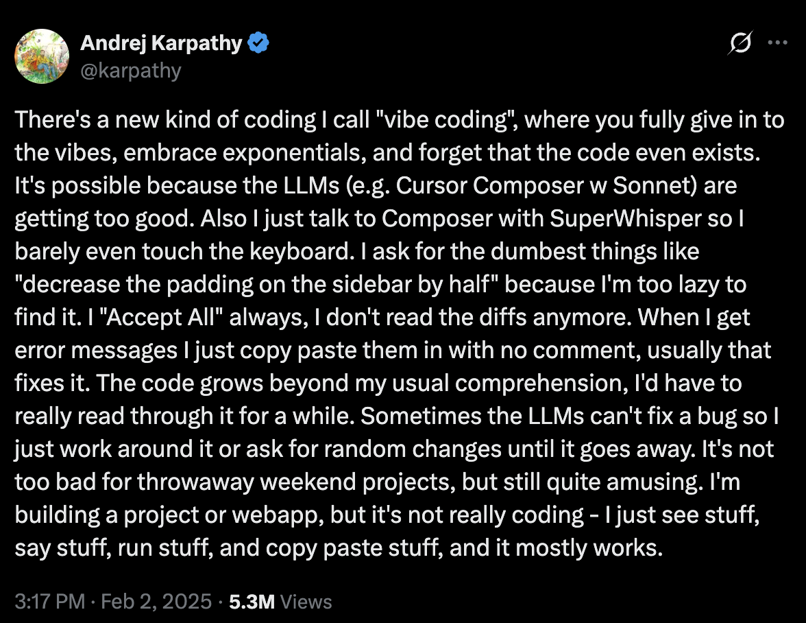
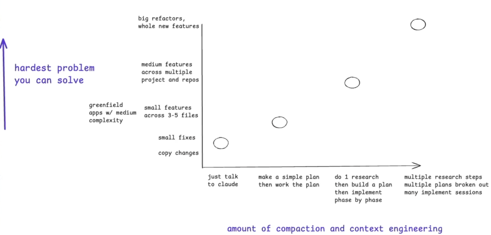

# 《现代软件开发者》第 3 讲：面向复杂代码库的高级提示与上下文工程

> **非官方中文翻译**，仅供学习参考，不代表原作者或斯坦福大学。
> 源幻灯片：[`0929-context-engineering en.pptx`](./0929-context-engineering%20en.pptx)
> 抓取日期：2026-10-22
> 说明：按原 pptx 逐页全文翻译，保留原始 URL、代码、专名与时间戳；内嵌图片提取到 [`images/0929/`](images/0929/)，图中英文在图片下方给出中文对照。代码与命令保持原文，不执行。

## 第 1 页：现代软件开发者

**现代软件开发者**

CS146S

斯坦福大学，2026 年秋季

Mihail Eric

themodernsoftware.dev

## 第 2 页：课程事务

**课程事务**

- Factory 工作坊
  - 周四 18:20–18:45。
- 公布开源合作伙伴计划：
  - Anyscale（Ray）
  - Arize AI（Phoenix）
  - Browserbase
  - cmux
  - CopilotKit
  - CrewAI
  - HeyGen
  - Marimo
  - OpenHands
  - Pi
  - Unsloth AI
  - Vercel
  - Warp
  - Zilliz

## 第 3 页：面向复杂代码库的高级提示与上下文工程

**面向复杂代码库的高级提示与上下文工程**

> **演讲者备注**：这就引出了我们这门课……

## 第 4 页：课程导引

**课程导引**

**目标**

- 从临时起意的提示（ad-hoc prompting），进阶到稳健、可靠的同步 AI 开发工作流。
- 用 AI 快速上手不熟悉的代码库，并系统地完成复杂编码任务。

**课程计划**

- 学会如何快速上手大型、陌生的代码库。
- 通过 RePPIT 框架学习规格驱动工程（spec-driven engineering）：
  - 研究（Research）
  - 提议（Propose）
  - 计划（Plan）
  - 实现（Implement）
  - 测试（Test）
- 了解其他规格驱动的 AI 开发框架。

## 第 5 页：Karpathy 的“氛围编程”推文

图中文字中文对照：

> **Andrej Karpathy** @karpathy
>
> 我发明了一种新的编码方式，叫“氛围编程”（vibe coding）：你完全沉浸在氛围里，拥抱指数级增长，甚至忘记代码的存在。之所以可行，是因为 LLM（比如搭配 Sonnet 的 Cursor Composer）已经太强了。另外，我用 SuperWhisper 跟 Composer 说话，几乎都不用碰键盘。我会让它做特别蠢的事，比如“把侧边栏的内边距减半”，因为我懒得自己去找。我总是点“全部接受”（Accept All），再也不读 diff 了。遇到报错信息，我就直接复制粘贴进去，不加任何说明，通常这样就能修好。代码逐渐超出了我平常的理解范围，我得认真读一阵子才能明白。有时 LLM 修不好某个 bug，我就绕过它，或者让它随便改改，直到问题消失。对于周末的一次性项目来说这还不算太糟，但仍然挺有意思。我是在构建一个项目或 Web 应用，但这其实不算真正在写代码——我只是看看东西、说说话、跑一跑、复制粘贴一下，而且大多数时候它还真能跑。
>
> 2025 年 2 月 2 日下午 3:17 · 530 万次浏览

## 第 6 页：氛围编程会混淆预期

**氛围编程会混淆预期**

> **演讲者备注**：“氛围编程”有不同定义，但这里关注的不是那种“直接 YOLO、一路 Tab 接受 AI 代码”的标准做法。

## 第 7 页：你会如何构建一个 Mint 克隆？

**你会如何构建一个 Mint 克隆？**

图中文字中文对照：这是三张 Mint 个人财务应用的界面截图，主要英文标签及中文含义如下：

- **Settings**：设置；**Overview**：总览；**Spending**：支出；**Budgets**：预算。
- **ACCOUNTS**：账户；**Cash**：现金；**Credit Debt**：信用卡债务；**$32,801**：32,801 美元；**-$18,034**：-18,034 美元。
- **BUDGETS November**：11 月预算；**TODAY**：今天；**CASH FLOW**：现金流；**$3,549 Earned**：已收入 3,549 美元；**-$811 Spent**：已支出 811 美元。
- **ALERTS**：提醒；**High Spending**：高支出；**ADVICE**：建议；**Save on interest and fees with Slate.**：使用 Slate 节省利息和费用。
- **SPENDING November 2013**：2013 年 11 月支出；**Auto & Transport**：汽车与交通；**12 Transactions**：12 笔交易；**Updated 11/05/2013 at 10:11 AM**：更新于 2013 年 11 月 5 日上午 10:11。
- **Food & Dining**：餐饮；**NOV**：11 月；**$198**：198 美元；**$2,739**：2,739 美元。
- **November 2013**：2013 年 11 月；**$321 Left**：剩余 321 美元；**$421 of $742**：已用 421/742 美元。
- **Gas & Fuel**：加油；**$136 Left**：剩余 136 美元；**$236 of $372**：已用 236/372 美元。
- **Alcohol & Bars**：酒类与酒吧；**-$24 Over**：超支 24 美元；**$44 of $20**：已用 44/20 美元。
- **Fast Food**：快餐；**$3 Left**：剩余 3 美元；**$47 of $50**：已用 47/50 美元。
- **Groceries**：杂货；**$205 Left**：剩余 205 美元；**$95 of $300**：已用 95/300 美元。
- **AUTO & TRANSPORT**：汽车与交通；**Updated 11/05/2013 at 10:03 AM**：更新于 2013 年 11 月 5 日上午 10:03。

## 第 8 页：编写生产级 AI 代码需要有条不紊

**编写生产级 AI 代码需要有条不紊。**

> **演讲者备注**：你应当对如何构建自己的解决方案，拥有一个主动、可运作的心智模型。

## 第 9 页：生产级 AI 代码的原则

**生产级 AI 代码的原则**

- 理解一个陌生的代码库。
- 提出一些解决方案。
- 为最有希望的方案制定计划。
- 实现它。
- 测试它。

> **演讲者备注**：如今所谓的坏代码，既包括架构上错误的决策，也包括功能上不正确的软件（由产生幻觉的 LLM 造成）。

## 第 10 页：使用 RePPIT

**使用 RePPIT**

## 第 11 页：RePPIT 五步法

**R**esearch（研究）

**P**ropose（提议）

**P**lan（计划）

**I**mplement（实现）

**T**est（测试）

> **演讲者备注**：这套流程需要你反复迭代，找到适合自己的做法；但这些高层要点应该能为你的工作流提供一个扎实的起点。

## 第 12 页：演示

**演示**

**功能：加入一条趋势线，按类别展示随时间变化的支出。**

## 第 13 页：上下文窗口与“变笨区”

**上下文窗口中 ½–¾ 的“聪明”token**

- System prompt（系统提示词）
- `AGENTS.md` / `CLAUDE.md`
- Task-specific context（任务特定上下文）
- the “dumb” zone（“变笨”区）

图中说明：原页用一条纵向堆叠的带状图表示上下文窗口的构成，从上到下依次是系统提示词、`AGENTS.md` / `CLAUDE.md`、任务特定上下文，最后是“变笨”区。左侧的括号标注表明，前三个部分大约占上下文窗口的 50%–75%，属于模型仍然“聪明”的区间；继续向下堆积内容，就会进入“变笨”区，模型表现开始下降。图中的英文标签中文对照已列在上方。

## 第 14 页：最佳实践

**最佳实践**

- 非常仔细地审查你的规格（spec）。
- 对于非常大的功能，把任务拆成任务清单。
  - 每完成一项，就用一份书面产物记录 agent 的工作。
  - 这份产物会成为继续下一项任务时可用的上下文。
- 时刻留意你的上下文窗口（½–¾ 的“聪明”token）。

## 第 15 页：任务委派分类法

**任务委派分类法**

**可选做法**

- 简单提示（Simple prompting）
- 制定计划（Make a plan）
- 先研究，再计划（Research then plan）
- （先研究，再计划）× N
- 每种做法分别在什么时候使用？

## 第 16 页：任务委派分类矩阵

图中文字中文对照与结构说明：

- 纵轴：**hardest problem you can solve**（你能解决的最难问题），向上表示问题越来越难。
- 横轴：**amount of compaction and context engineering**（压缩与上下文工程的程度），向右表示投入越来越多。
- 任务行，从难到易：
  - **big refactors, whole new features**：大型重构、全新功能。
  - **medium features across multiple project and repos**：跨多个项目和仓库的中型功能。
  - **greenfield apps w/ medium complexity**：中等复杂度的全新应用。
  - **small features across 3-5 files**：跨 3–5 个文件的小功能。
  - **small fixes**：小修复。
  - **copy changes**：文案/复制内容的修改。
- 委派方式列，从左到右：
  - **just talk to claude**：直接跟 Claude 说。
  - **make a simple plan then work the plan**：做一个简单计划，然后按计划执行。
  - **do 1 research then build a plan then implement phase by phase**：做 1 次调研，然后制定计划，再分阶段实现。
  - **multiple research steps multiple plans broken out many implement sessions**：多轮调研、拆成多个计划、进行多次实现会话。
- 图中用色块把不同难度的任务与推荐的委派方式对应起来；任务越难，越需要向右采用更重的调研、计划和上下文工程流程。

## 第 17 页：其他流行框架

**其他流行框架**

**Superpowers**

- 一套有明确主张的端到端引导式工作流，用于解决复杂任务。
- 基于 TDD（测试驱动开发）。
- 一组 agent 技能，可用于创建规格/计划、实现和测试。
- 内置并行能力。

**OpenSpec**

- 用于编写规格、实现计划等的轻量流程。
- 有一套很好的方法：在作为事实来源（source of truth）的规格中跟踪变更，并在产生 diff 之后合并这些变更。

## 第 18 页：规格管理

**规格放在哪里？**

- Linear，或者本地/Git（按照 OpenSpec 的做法）。
- 代码库某些部分的设计权衡/决策点，可以放在 `.notes/` 中。
