# 1001-mcp-and-tools — slide transcript

> Unofficial English text extraction from the source `.pptx`, one section per slide, in presentation order.

> Source: [`1001-mcp-and-tools en.pptx`](./1001-mcp-and-tools%20en.pptx) · extracted 2026-10-22 · images in `images/1001/`

## Slide 1

- The Modern Software Developer
- CS146S
- Stanford University, Fall 2026
- Mihail Eric
- themodernsoftware.dev

## Slide 2

- Logistics
- OSS Partner assignments out tonight
   - AI slop gets a 0
- Project Proposals due tonight
- Ashley Jepson (Factory) giving a workshop
- themodernsoftware.dev

## Slide 3

- MCP, Tool-calling, and Beyond
- themodernsoftware.dev

**Speaker notes:**

- Which brings us to this course…

## Slide 4

- Why
- LLMs have vast (but static) world knowledge that only updates when we retrain
- To build fully autonomous systems we need robust ways to feed dynamic data in
- themodernsoftware.dev

## Slide 5

- MCP
- Model Context Protocol
   - Open protocol that allows systems to provide context to AI models in a manner generalizable across integrations
      - In English: standard format for exposing tools to LLMs
- themodernsoftware.dev

## Slide 6

- Basics
- MCP
   - Does away with the need to build M x N connectors from LLM host/agent to underlying tool
      - Don’t need to reimplement auth, error handling, rate-limiting, etc
      - Enforces consistent output format using JSON-RPC
   - Integrating with tools goes from M x N →M + N connectors
- themodernsoftware.dev

## Slide 7

- themodernsoftware.dev

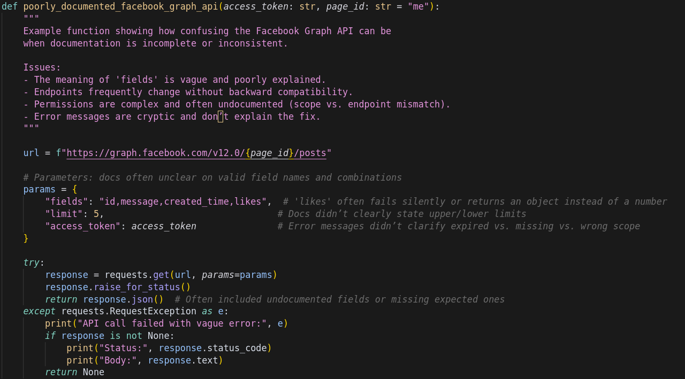

- Originally

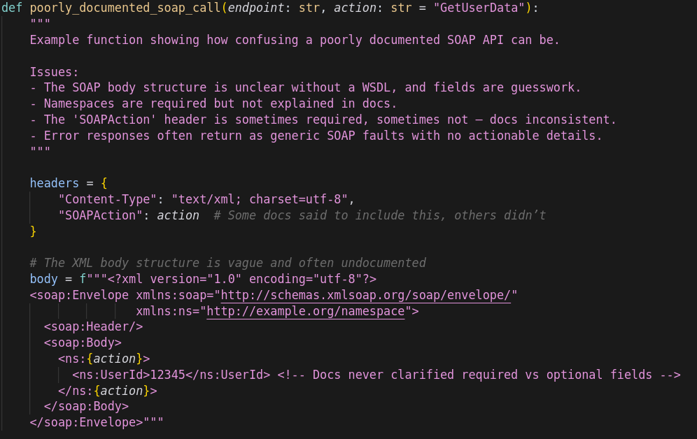

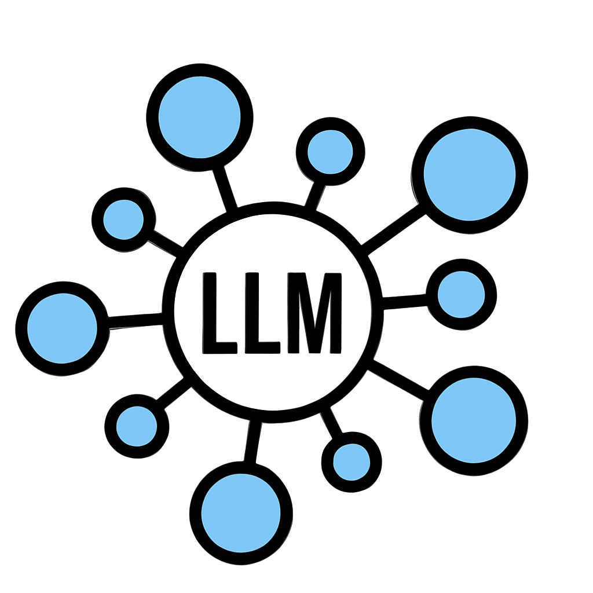
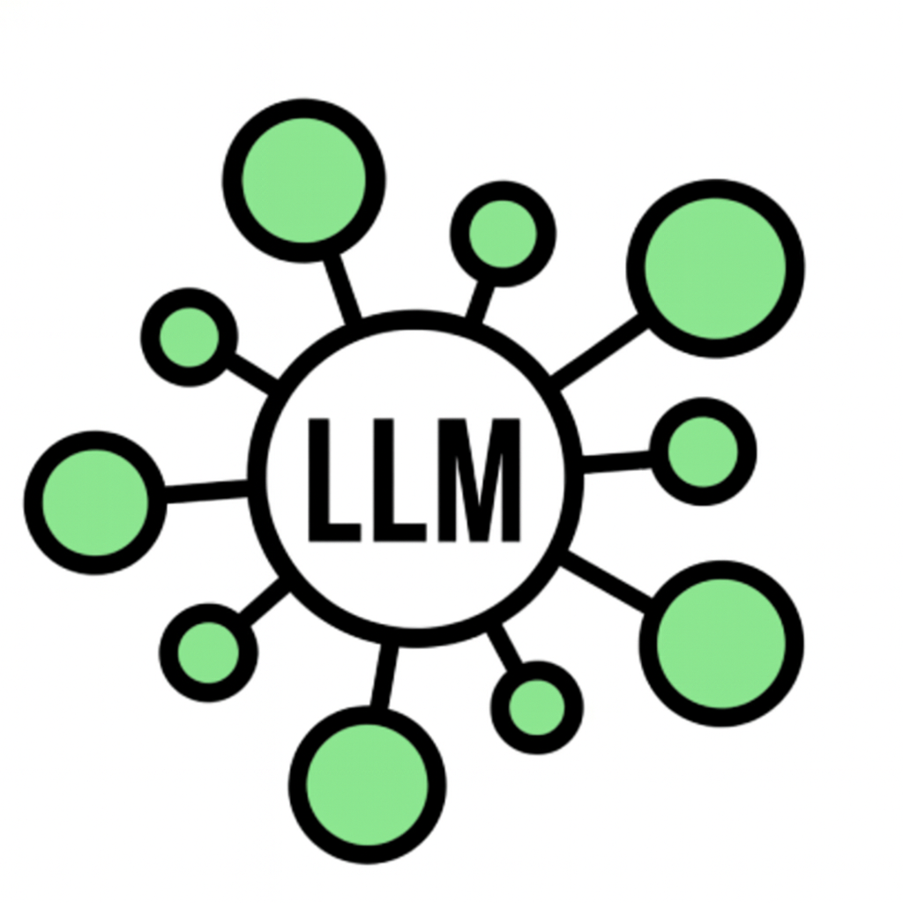

**Speaker notes:**

- Separate connector for each LLM -> API

## Slide 8

- themodernsoftware.dev

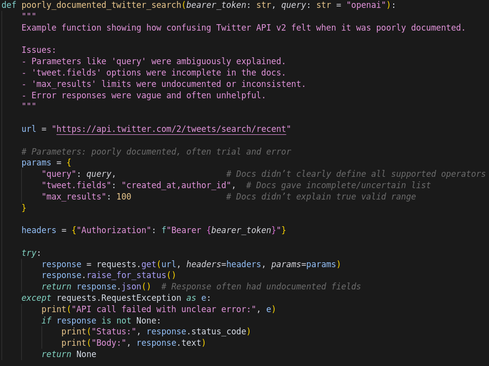

- Now with MCP

- MCP

## Slide 9

- MCP A Bit Deeper
- Terminology
   - Host: Cursor, Claude Desktop
   - MCP Client: Library embedded on host (stateful session per server)
   - MCP Server: Lightweight wrapper in front of a tool
   - Tool: Callable function (could be data source, API)
- Flow
   - Client calls tools/list to MCP server (what can you do?)
   - Server returns JSON describing each tool (name, summary, JSON schema)
   - Host injects that JSON into model’s context
   - User prompt triggers model, emitting a structured tool call
   - MCP server executes and conversation resumes
- MCP provides stdio and streamable HTTP transport layer
- themodernsoftware.dev

## Slide 10

- themodernsoftware.dev

- MCP client
- Summarize my emails from Jack

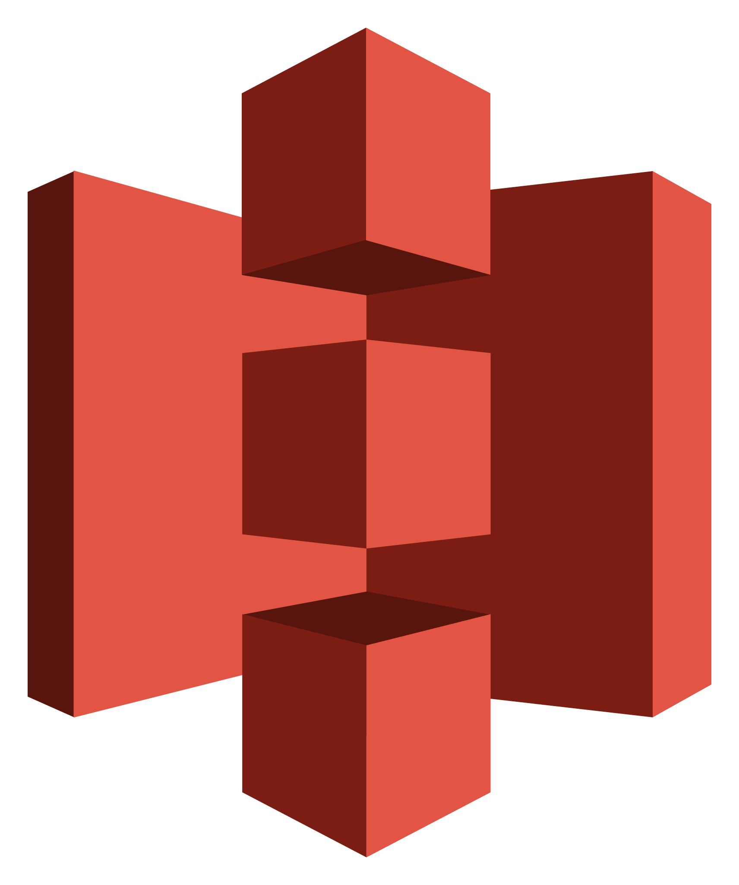

- MCP server

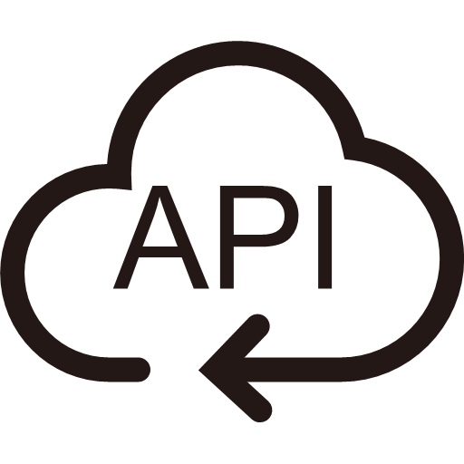

- 1
- Ask query
- 2
- Get tools
- 3
- Send query and pick tool with params
- 4
- Call function for tool and get response
- Send response
- 5

## Slide 11

- How to design a good MCP server (Option 1)
- MCP is not a REST API wrapper
   - Too many small tools
   - Large, complex contexts
   - Agents spend too much time orchestrating logic
- Best practices
   - Design for outcomes not operations
      - send_payment(user_email) NOT get_users(user_id) → list_account(user_email) → send_payment(account_id)
   - Explicit arguments
      - Not nested dict inputs
   - Instructions are context
      - Docstrings, error messages, etc are prompts
   - Name tools for discovery
      - Service-prefixed tool names
- themodernsoftware.dev

## Slide 12

- How to design a good MCP server (Option 2)
- As # of MCP servers explode, only expose two tools: search and execute
- Agent calls search to find relevant tools and definitions
- Execute generates deterministic code to perform an operation
- Massive context reduction and approach is agnostic of how many MCP servers there are
- 90+% token reduction
- themodernsoftware.dev

**Speaker notes:**

- Load tools on demand, filter data before it reaches the model, and execute complex logic in a simple step

## Slide 13

- How to design a good MCP server (Option 2)
- themodernsoftware.dev
- Find a Jira ticket and update with info from Google drive

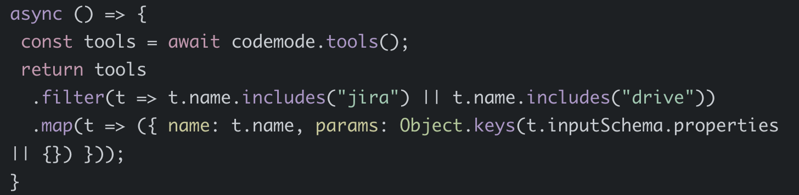
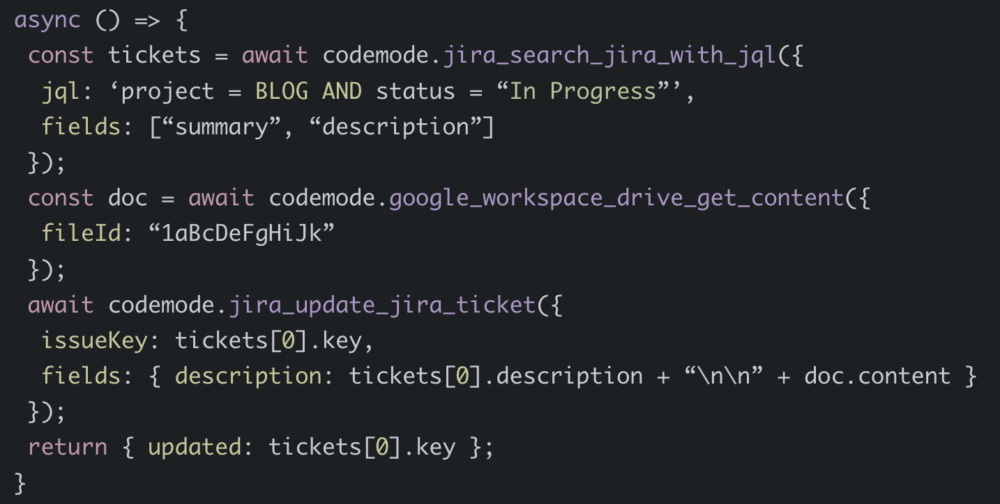

**Speaker notes:**

- Load tools on demand, filter data before it reaches the odel, and execute complex logic in a simple step

## Slide 14

- Advanced MCP Architecture Design
- themodernsoftware.dev

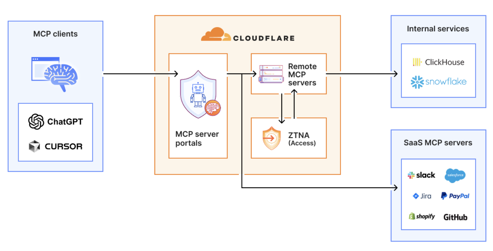

**Speaker notes:**

- The employee simply connects their MCP client to the MCP server portal, and the portal immediately reveals every internal and third-party MCP servers they are authorized to use.
- Beyond this, our MCP server portals provide centralized logging, consistent policy enforcement and data loss prevention guardrails

## Slide 15

- Agent Skills
- themodernsoftware.dev
- A standard for dynamically loaded agent capabilities
   - Domain-specific
   - Combine code and prompts
   - Loaded by agent as needed
- Use cases
   - Document authoring
   - Powerpoint creation
   - Data analysis
   - …and more

**Speaker notes:**

- https://agentskills.io/home

## Slide 16

- Agent Skills
- themodernsoftware.dev

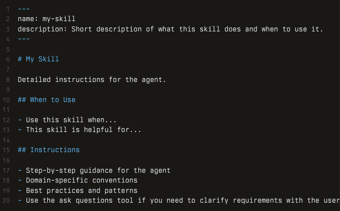

**Speaker notes:**

- Provide a skills.md
- Show example of gws agent skills: https://github.com/mattpocock/skills

## Slide 17

- APIs vs MCP vs Skills
- themodernsoftware.dev
- APIs
   - What: HTTP/REST/GraphQL service interfaces exposed by app for developers to call
   - Who: You call or an SDK
   - Usage: You decide auth, retries, paginations, input validation, etc
- MCP
   - What: Tool definitions exposed by a server so an LLM agent can invoke them in a standardized way
   - Who:  model/agent runtime (as “tool calls”), not a human developer writing bespoke integrations each time
   - Usage: Main mechanism for interacting with external resources, data, services
- Skills
   - What: Reusable task packages / procedures that teach an agent how to do a job, often by orchestrating multiple tools/endpoints
   - Who: Agent or agent framework as higher level capability it can reach for
   - Usage: Workflow abstraction - “here’s the repeatable way to complete X.”
