# 上下文税：什么时候该压缩你的 Coding Agent

> 作者：Rogerio Chaves（LangWatch）
> 原文：<https://langwatch.ai/blog/context-tax-when-to-compact>（2026-08-02）
> 英文原文：[Context Tax en.md](./Context%20Tax%20en.md)
> 配套论文：[Finding the Optimal Context Window for Coding Agents](https://langwatch.ai/research/finding-the-optimal-context-window)
> 数据来源：作者本人 162 天的 Claude Code 会话 trace（2,451 个 agent 会话、287,748 次 API 调用、201 个人工审计步骤、873 次压缩）
> 译文说明：保留 `compact / compaction`（压缩）、`context window`（上下文窗口）、`subagent`（子 agent）等术语英文，数字与图表保持原样。

对 2,451 个 agent 会话、287,748 次被 trace 的 API 调用、201 个人工审计步骤和 873 次压缩的分析：该压缩了。

*作者 Rogerio Chaves · 2026 年 8 月 2 日*

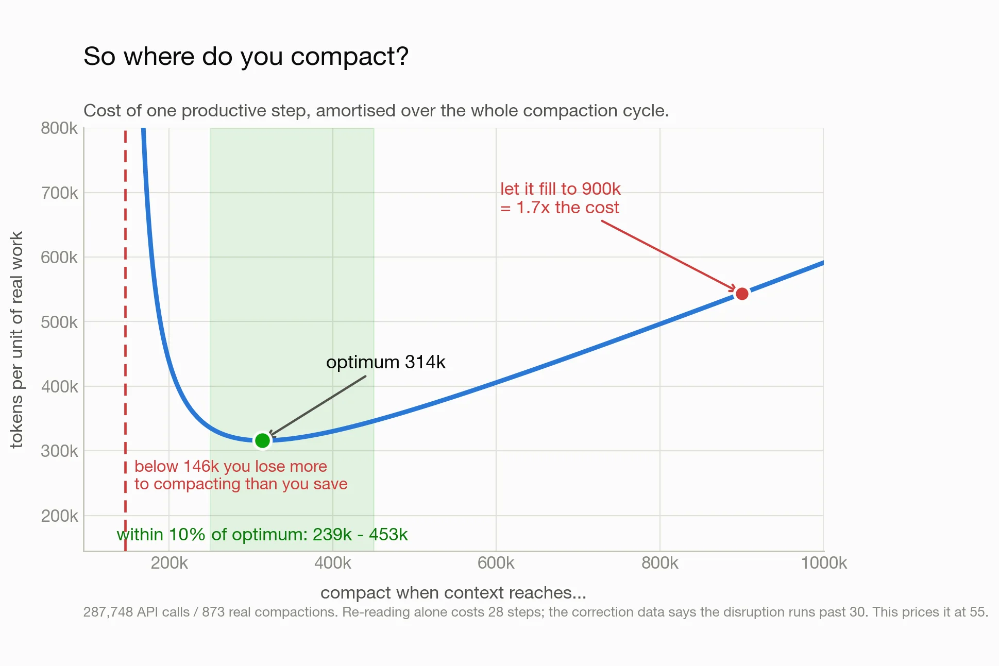

## TL;DR

你应该压缩，而且大概率比现在更频繁。区间大约在 250k 到 450k tokens。上下文每翻一倍，成本约涨 6 倍，所以要谨慎决定哪项工作配得上一个大窗口。我找不到任何正当理由，让 agent 跑到接近 1M。

大上下文窗口的成本，并不像它看起来那样。当你的 agent 在 500k 上下文下、为一次追问发起 25 次工具调用时，那不是一次 500k tokens 的缓存请求，而是 25 × 500k，并且还在增加。即便缓存 token 比非缓存便宜一个数量级，那仍然是**巨量**的 token 燃烧。与此同时，agent 真正用到的那部分窗口几乎不增长：16 倍的窗口，携带的有用上下文大致相同。

单看 token 消耗，看不出压缩的质量代价：压缩之后的几十步里，agent 的决策明显变差。所以我们把这一项也建模了——模型因为压缩（而非更长的原始窗口）犯更多错所带来的长期成本——即便如此，仍然无法在 token 上为这笔交易找到正当性。

下面是完整分析。

> 本文每个数字都来自用 [LangWatch Claude Code usage tracking](https://langwatch.ai/claude-code-usage) 对我自己 Claude Code 会话的 trace。一条 `npx langwatch claude`，你就能对自己的 token 用量跑同样的分析。

## 限额死掉的那一天

七月最后一个周五，我的会话限额从「还好」到「耗尽」只花了几分钟。我等了 5 小时，恢复工作，几分钟后 token 又耗尽了。搞什么？所有会话都以同样的方式结束：

```
Agent terminated early due to an API error:
You've hit your session limit · resets 11:10pm
```

我有一个怀疑对象：subagent。

查 LangWatch：**一天 22.5 亿 tokens**，其中 82% 来自 subagent，而不是我敲进去的任何东西。该死。

幸运的是，我现在可以让一个 Claude 去调查我其他 Claude 的 token 花费，并和它对话。我机器上每个 `claude` 都跑在一个注入 OpenTelemetry 的 wrapper 后面，所以每个会话都会落成一条 trace，成本、cache reads 和 cache writes 作为独立的 token 类别，每条 bash 命令都是一个 span。我把它和 Claude Code 在本地写的原始 session jsonl 日志混在一起分析。

## 两个 agent 花掉了半天

在 22.5 亿 tokens 里，**有 11.4 亿来自三十四个 subagent 中的两个**。它们都是 forked subagent，也就是说，它们出生时持有父协调者对话的完整副本。给它们的简报要求执行一条指令然后**停下**，但它们从未停下！一个活了 10.7 小时、发起 1,301 次 API 调用，另一个 8.7 小时、595 次。

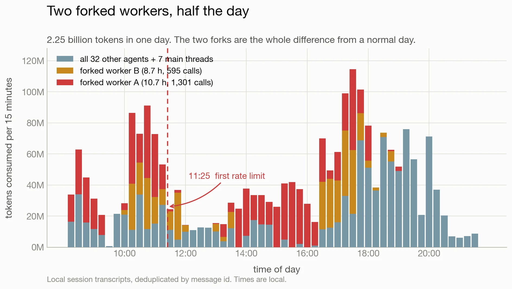

三个平平无奇的决定相乘，造成了这个结果。fork 从父级的上下文大小开始，所以这两个从 523K 和 304K tokens 起步，而不是新 subagent 通常拿到的约 30,000。长生命周期 worker 只会在此基础上继续累积，第一个峰值达到 997,634 tokens，距离模型的硬上限只差 0.3%；而每一次 lint、typecheck 和 test 运行，都是又一次重新读取整个窗口的 API 调用。那个 worker 跑了 1,112 条 bash 命令。按它的平均上下文，一次 `pnpm test` 在测试真正开始干活之前就要花掉约 568,000 tokens。

单独看，这三个决定都不离谱：fork 保住了花数小时建立的上下文，长生命周期 worker 免去了重新交代，通过 shell 迭代本来就是构建的常态。但三者叠加，把这两个 agent 变成了极端离群值：连续几百步里，每步的代价都高于我大多数 agent 一整项任务的消耗。

## 这笔税是幂律

那么一般情况如何放大？在全部 162 天的 trace 中：当一个 agent 的上下文首次达到规模 C 时，它已经为此烧掉了多少 tokens？

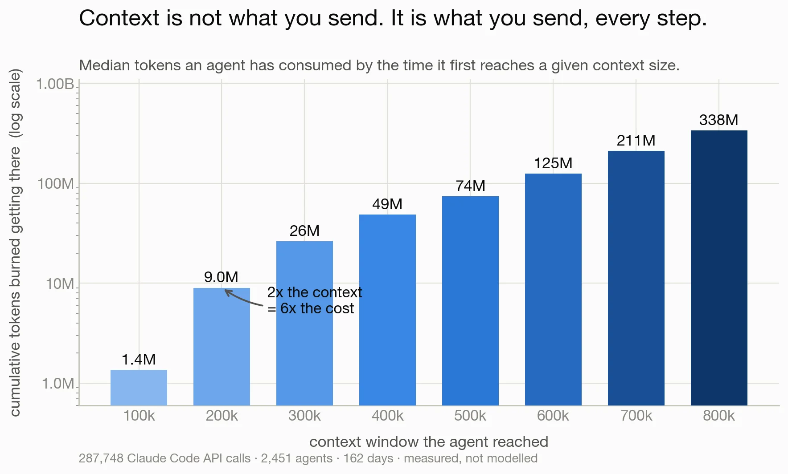

达到 100k 上下文，中位数成本 140 万 tokens。达到 200k 是 900 万。达到 800k 是 3.38 亿——窗口是 8 倍，成本是 100k 那个数字的 250 倍。

拟合结果是幂律，指数 **2.55，R² = 0.994**；在子区间上重拟合时保持在 2.36 到 2.66 之间。换句话说，上下文每翻一倍，成本约涨 6 倍。

为什么是 2.5 而不是标准的二次方？二次方是「每步新增固定量上下文」时你会得到的结果：每步更贵，步数也更多。但每步新增的量会随着窗口填充而缩小——50k 以下约每步 3,200 tokens，200k 以上稳定在 1,470——所以窗口的最后一段是由许多小增量累积出来的，而每一个小增量都按整窗价格付费。

缓存在这里也救不了你。cache read 每个 token 确实便宜约 10 倍，但它们也是爆发日消耗总量的 95%：一个被缓存的 token 仍然是你每一步都要再买一次的 token。缓存降低了每次重读的单价，而「每翻倍 6 倍」的增长依然存在。

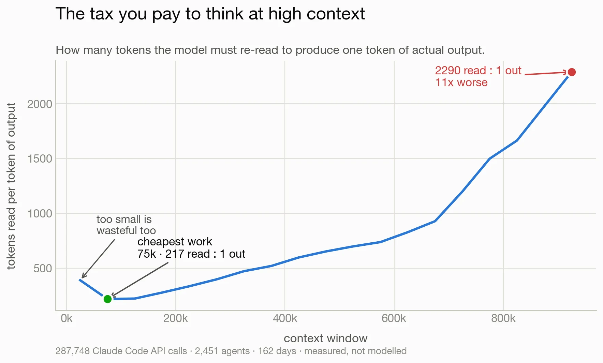

用读入 tokens 除以输出 tokens，就得到直接的税率，曲线是个 U 形而不是斜率：在 75k 附近触底，为每产出 1 个 token 读 217 个；到 900k 时达到 2,290 : 1。U 的左侧同样有意思：低于约 50k 时，模型还没积累到足以产出实质内容，所以过小的窗口同样是浪费。既有地板也有天花板，所以「不停地压缩」也不是答案。

知道任务是什么，也无助于预测成本：成本 = 窗口 × 步数，而步数几乎不可预测。

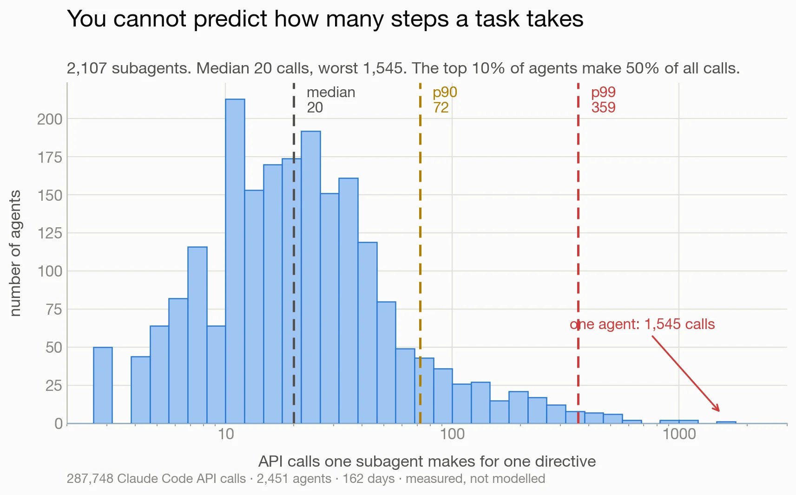

在 2,107 个各被交付一条指令的 subagent 中，中位数需要 20 次 API 调用。90 分位是 72 次，99 分位 359 次，最差的一个 agent 用了 1,545 次。前 10% 的 agent 占了一半的调用量。你无法看着一个任务就知道自己落在哪个区间，而你给这个 agent 的初始上下文，会被那个答案乘起来。

## 如果只算成本，压缩在哪里划算

压缩是泄压阀：用摘要替换对话，然后继续。它自身也有成本，所以这里存在真实的优化空间，而我可以从日志里把参数全部标定出来，而不是猜。

在我机器上 **873 次真实压缩事件**中，一次压缩把会话降到中位数 65,588 tokens，之后上下文以每步约 1,470 tokens 增长；在随后大约 28 步里，agent 以高于自身稳态速率的速度重新摄入上下文——重读文件、重建它原本「直接就知道」的状态。最后这个数字，就是丢失原始上下文所付出的实测代价，也正是「不停压缩」会失败的原因。

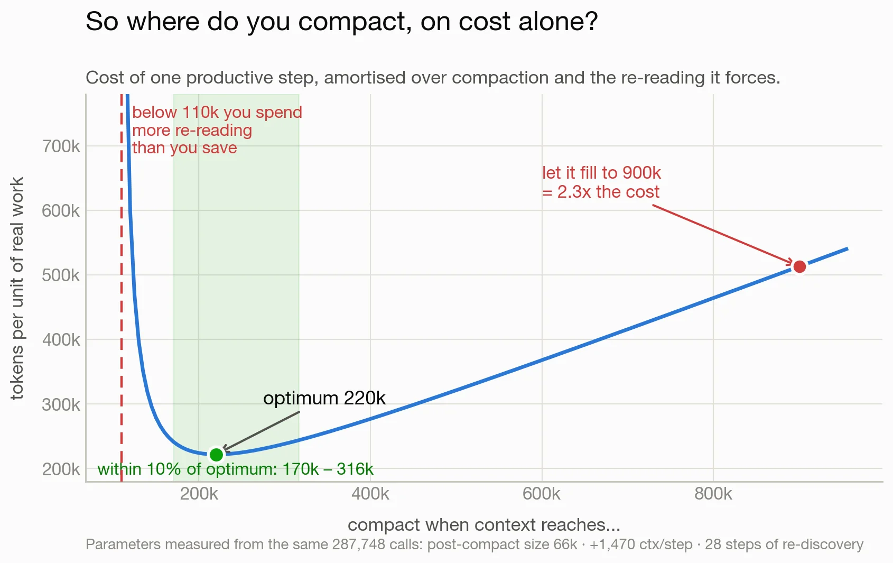

把整个循环放在一起，每单位真实工作的成本是个左侧陡峭的浴缸曲线。最小值落在 **220,000 tokens**，170k 到 316k 之间都在最优值的 10% 以内；低于约 110k，整个机制失效，因为重新发现的代价吃掉的步数超过了循环本身给出的回报。

不对称性才是实践中真正有用的部分。早压缩 90k，成本是最优的 1.79 倍；晚压缩 96k，成本是最优的 1.10 倍。拿不准时，宁可晚一点。这也对百万 token 模型说了句具体的话：让窗口填满再压缩，比在 220k 压缩差 2.3 倍，所以更大的窗口是更多的绳子，而不是免费升级。

那个模型建立在自己的假设上，所以我想要一个完全不共享这些假设的验证。对 agent 碰过的每个文件，我测量它上一次被触碰距今有多远，以中间历史长度的 tokens 计。没有模型，没有裁判，只有文件路径。

在 10,037 次重复引用中，中位数只有 7,430 tokens 之遥，但尾部很长。100k 窗口能覆盖 72.4% 的重复引用，200k 覆盖 77.6%，500k 覆盖 82.6%。剩下的 17% 跨越数百万 tokens，没有任何窗口能容纳它们，所以 82.6% 就是天花板。因此 200k 窗口达到了**窗口所能达到的全部范围的 94%**，而「单位成本覆盖率」在 **240,000 tokens** 处达到峰值。

两个互不相关的方法分别落在 220k 和 240k——这是我开始相信这个数字的时刻。

## 但这些上下文里，有多少真的有用？

以上全部度量的是上下文的成本，而不是它是否在起作用；成本数据回答不了这个问题：token 无论有没有贡献都会被计费。

### 审计是怎么做的

所以我做了一次审计。我把语料切成 3,036 个 run，每个从一次会话开始或压缩边界延伸到下一个边界，再按工具与命令签名把它们归为五类工作：代码理解、调研、构建、QA 与 dogfooding、推动一个 PR 走到合并。然后我按工作类型和该步实际存在的上下文进行分层抽样。

对每个被抽中的 run，一个 Opus 裁判拿到 agent 当时面前的一切：指令、任何继承来的摘要（明确标注为有损摘要）、一份带 token 数的累积对话条目编号清单，以及三个抽样步骤，展示 agent 看到什么、做了什么。裁判标记每一步实际用到了哪些条目。我从他们的条目列表计算 token 占比，而不是直接问一个百分比——这样数字就不在裁判手里。**共评判 201 步，其中 195 步为中或高置信度。** 完整评分细则、数据包格式和全部实测参数都在[配套论文](https://langwatch.ai/research/finding-the-optimal-context-window)里。

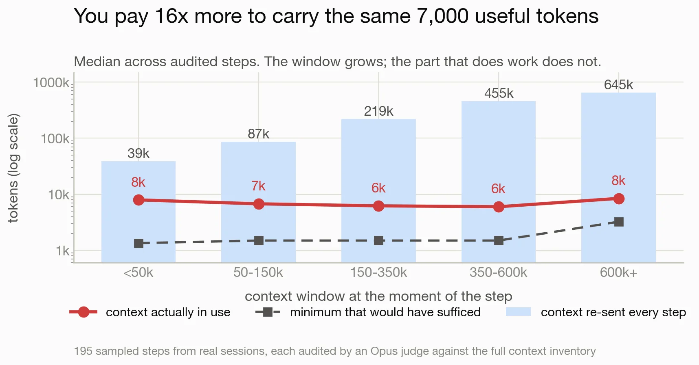

各分档的窗口增长了 16.6 倍，从中位数 38,886 tokens 到 644,962。裁判标记为「实际在用」的部分从 7,949 增长到 8,452，也就是说它压根没动。他们对「完成同一步所需的最小上下文」的估计，除最大一档外，每一档都在 1,500 tokens 附近。

作为占比，在用上下文从 50k 以下的 **47.5% 降到 600k 以上的 2.5%**：有用的部分原地不动，而你付费的窗口在它周围长大。

显而易见的反驳是任务构成不同，因为不同工作有不同的记忆需求。

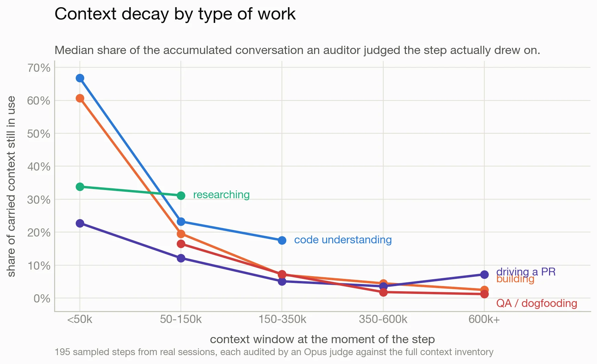

衰减在五类工作中都出现，而它们之间的差异是可解释的。代码理解保持价值最久，在 150k 到 350k 仍有 18%，因为阅读是累积的，每读一个文件都与正在拼装的解释相关。QA 和推动 PR 衰减最快，因为每次浏览器检查或评审回复都是一个闭环，其结果取代了它的输入。

那张图有一个前提需要注意。在我的使用中，工作类型和窗口大小是混杂的：调研和代码理解很少超过 150k，QA 和推动 PR 很少低于它，因为它们发生在长会话的后期。只有「构建」跨越全部五个分档，所以它携带最干净的梯度，其他每条线只能在其覆盖的区间内解读。

### 逐字上下文，还是摘要就够？

重度用户倾向于相信原始对话比它的任何摘要都更有价值，而这正是压缩所摧毁的东西。所以对每一步，裁判都被问：旧上下文的逐字形式，是否在做摘要无法承载的工作？

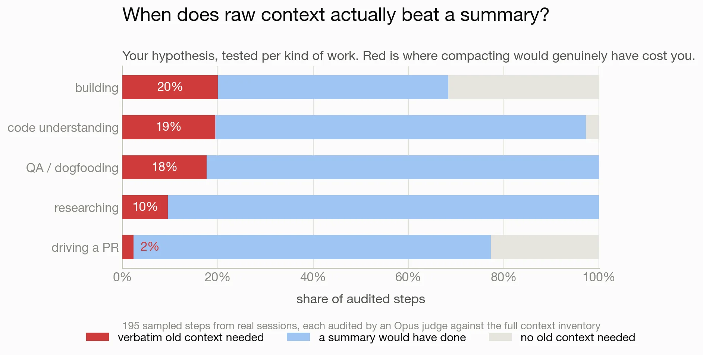

**195 步中有 28 步（14%）确实需要旧的逐字上下文。** 这些案例高度集中在复制精确字符串上。一次编辑的 search text 必须与之前读过的文件逐字符匹配，就需要那次逐字读取。一条重启命令复用了 390 个条目之前的字面连接串，就需要那条逐字命令。当依赖项是一个决定、一个约束或一个发现而不是字面量时，摘要就能很好地承载它。有一个 622k 的案例里，该步所依赖的那一条旧事实，是通过一份手写摘要传过来的——这大概是数据能给出的最直接的反例。

按工作类型分布差异足够大，可以据此行动。构建、代码理解和 QA 在 18% 到 20% 的逐字依赖。推动 PR 只有 **2%，没有任何一步会被压缩实质性损害**。

对每个裁判都提出的反事实是：把除最近 30k 之外的一切替换成 5,000 tokens 的摘要——85% 的步骤不受影响，15% 轻微退化，195 步中有 4 步实质性退化，0 步变得不可能完成。

单看这些，到目前为止的一切都在说同一件事：早点压缩，大约 150k 到 220k，PR 工作还要更低。

## 让结论复杂化的部分

但那次审计有幸存者偏差，而在这里它很关键：裁判只给实际发生的步骤打分。一个因为某些内容被摘要掉而悄悄出错的步骤，不会表现为「坏步骤」，它会表现为一个正常步骤，只是后果稍后才到——在评审里，或在生产环境里。所以上面每一个压缩结论，都乐观了某个未知的量。

我自己的经验也一直在挑战这些数字。我在 500k 到 600k 压缩，这个数字远在我关心成本之前就靠试错定下了，因为更早压缩会让 agent 明显变差，而我无法精确指出原因。主观质量很难测量，但行为可以。

### 测行为，而不是测质量

于是：用 700 份 transcript 中的 128,853 个观测，做两个代理指标。一是工具调用返回错误的比例；二是我自己的消息中包含纠正的比例，用短语匹配检测。两者都对照「距上次压缩过了多少步」来测，这样比较保持在单个会话内部，并大致控制住任务难度。

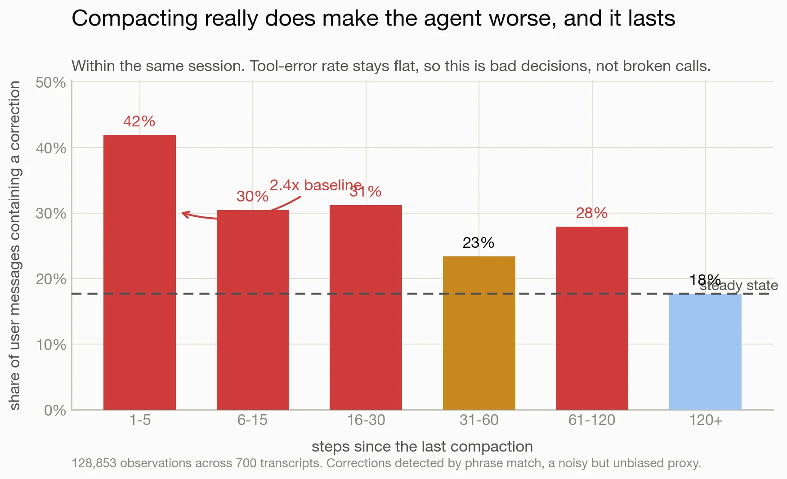

在压缩后的五步内，**我的消息中有 41.9% 包含纠正，而稳态基线是 17.7%**。这是 2.37 倍，至少持续升高 30 步，到 120 步仍未完全恢复。同一窗口内，工具错误率平稳在 2.6% 到 3.2%：调用依然能用，背后的决策变差了。

测量压缩事件本身可以解释原因。在那 873 次压缩中，中位数把 **574,875 tokens 的窗口压成 4,382 tokens 的摘要**：原始材料存活的不到 1%，每次事件的中位墙钟成本是 142 秒。

压缩频率再把它放大。在一个 105 步的周期里出现 30 步的扰动——这正是 220k 阈值给你的东西——意味着**你所有步骤中约 29% 发生在压缩后的迷雾里**。在 577k 阈值下，周期是 348 步，该数字降到 9%。频繁压缩不仅付出重新发现的成本，还不断把你放回周期里最糟糕的那一段。

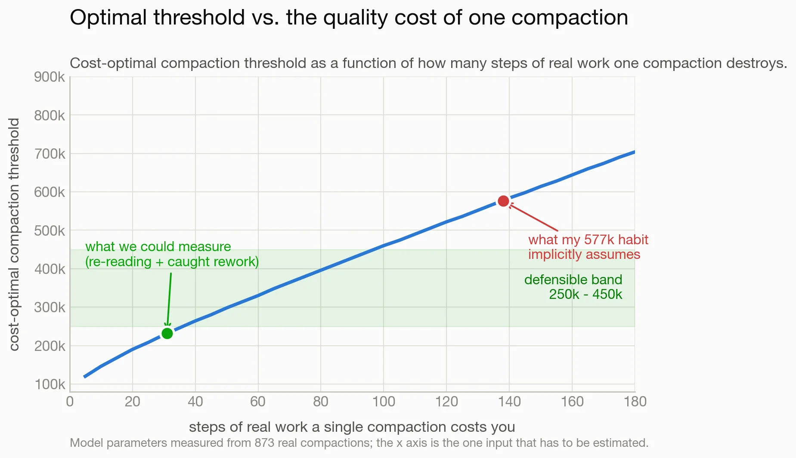

所以最优点几乎完全取决于一个难以测量的参数：一次压缩摧毁了多少步真实工作。

| 如果一次压缩的真实代价是 | 成本最优阈值 |
|---|---|
| 28 步（仅重新发现，实测） | 220,000 |
| 31 步（加上我明显抓到的返工） | 232,000 |
| 65 步 | 350,000 |
| 113 步 | 500,000 |
| 138 步 | 577,000 |
| 145 步 | 600,000 |

我能测到的大约是 31 步。跑 600k 阈值（就像我这样）隐含地断言：一次压缩的代价约为 145 步，是可测数字的五倍。考虑到纠正率在 100 步之后仍然偏高，这个信念不算不合理。但它也不是一个已被确立的信念，我想说清楚我主张的是哪一种。

### 宽窗口到底花了多少钱

宽窗口在 token 经济学上也并不能自付成本。从 232k 阈值到 600k，每 1,000 个有效步骤多花 1.39 亿 tokens，减少 6.1 次压缩扰动，也就是说你为每次避免的扰动付出约 **2,300 万 tokens**。要打平，一个逃逸出去的缺陷需要花费 4,600 万到 2.29 亿 tokens，取决于扰动泄漏缺陷的频率；而一次彻底的调试会话只花几百万。

如果你想为宽窗口辩护，请用生产缺陷的真实代价来辩护：工程师工时、客户信任、从上线到被发现之间的那几周。这些都不在这个数据集里，所以这项分析最多只能给你汇率。

于是我重跑了同一个模型，这次把一次压缩记为 55 步损失的工作，而不是 28 步，因为纠正数据显示损害远远超出重读。最便宜的阈值从 220k 移到 314k，239k 到 453k 之间的任何值都落在最优值的 10% 以内。下面的建议就来自这个区间——是模型给出的，不是我。

不过 146k 这个地板更有意思。一次压缩把你降到约 66k，上下文每步增长约 1,470 tokens，所以把阈值设在 146k，你在下次压缩到期前买到 55 步。如果每次压缩要你付出 55 步的退化工作，你整个周期都在从开启它的那次压缩里恢复，永远得不到一个干净的步骤。比这更频繁地压缩，什么也买不到。

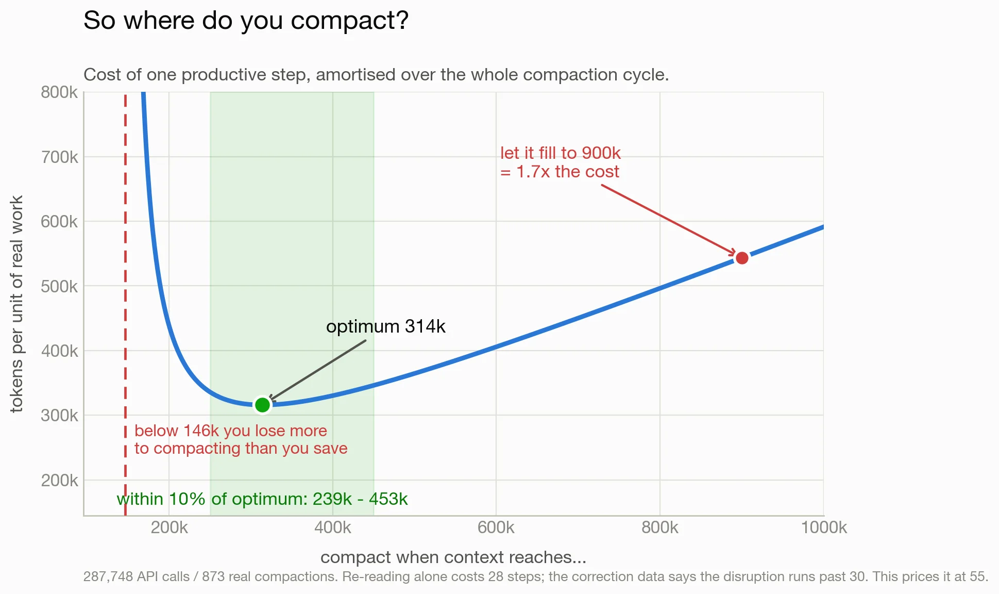

## 结论落在哪里

四个测量中有三个指向同一个地方：成本模型给 220k，单位成本覆盖率给 240k，审计给 120k 到 190k。第四个——压缩后的纠正尖峰——推向反方向。把它们调和起来，得到的是一个范围而不是一个数字。

| 工作类型 | 建议阈值 | 理由 |
|---|---|---|
| 推动 PR | 200k 到 250k | 2% 逐字依赖，无实质性退化 |
| 调研 | 250k 到 300k | 自包含，无实质性退化 |
| QA 与 dogfooding | 250k 到 350k | 衰减快，但 6% 实质性退化 |
| 构建 | 300k 到 450k | 逐字依赖最高，需要精确字符串编辑 |
| 代码理解 | 300k 到 450k | 衰减最慢，价值持续累积 |

低于约 200k，压缩后的迷雾开始吃掉你的工作时间。高于约 600k，你在为一项我在这些测量中找不到的好处支付大笔溢价。

如果你想要方法而不是论证，整个研究在 [Finding the Optimal Context Window for Coding Agents](https://langwatch.ai/research/finding-the-optimal-context-window) 里有正式成文，包含成本模型、敏感性分析和参数表。

不过，还有一个比阈值更大的杠杆。伤害集中在「切」的那一刻，而今天只有 0.8% 的窗口能在那一刻存活。保留 30k 到 60k 的逐字尾部、而不是 4,382 tokens 的摘要，直接攻击退化的窗口：在同一模型下，350k 阈值 + 60k 保留尾部的单位工作成本，比 600k 阈值 + 摘要低 25%，而且它让每次扰动更浅，而不只是更少。

而最大的变量是 agent 的起点。新的 subagent 从 30k 附近开始。从满载父级 fork 出来的，则从父级当时所在的位置开始：本文开头那两个从 523K 和 304K 起步，从起跑线就开始付幂律的税。

## 注意事项

这些都是我自己的使用：主要是 agentic coding，主要在 LangWatch 代码库上。你的常数会不同。我预期这些形状（幂律、平坦的有用上下文线、压缩后尖峰）比精确数字更有普适性，但我只在这里验证过。

在我的数据中，工作类型和窗口大小是混杂的，所以按任务的曲线只在各自覆盖的区间内有意义。

效用审计带有上文描述的幸存者偏差：它给发生过的步骤打分，看不到后来出错的步骤。纠正率的测量正是为了补上这个洞。

纠正测量是观察性的，不是实验：有时我压缩是因为事情已经变糟了，这本身会夸大压缩后的尖峰。升高持续超过 100 步就较难用这个解释了，但一个按固定 token 触发压缩的 harness 能给出定论。如果你跑一个，我想看你的数字。

## 方法

全部来自 162 天的本地会话 transcript，加上用于事件还原的 gateway trace。用量记录按 message id 去重（Claude Code 在每个 content-block 行上重复同一个 `usage` 对象，会让朴素求和虚高 1.7 倍）。每次调用的上下文 = cache reads + cache writes + fresh input。

累计成本曲线：对每个 agent，取第一次到达各 25k 档位时的累计值，再对 agent 取中位数。压缩事件来自显式边界记录，n=873，同时携带压缩前上下文、触发类型和耗时。重新发现 = 压缩后 25 步内摄入的、相对于该 agent 自身中位步增长的超额上下文，以「步当量」计。引用距离在同一文件路径的连续触碰之间测量，并在边界处重置。质量代理指标跑在 700 份 transcript 上，纠正在非工具结果的用户消息中通过短语匹配检测。
