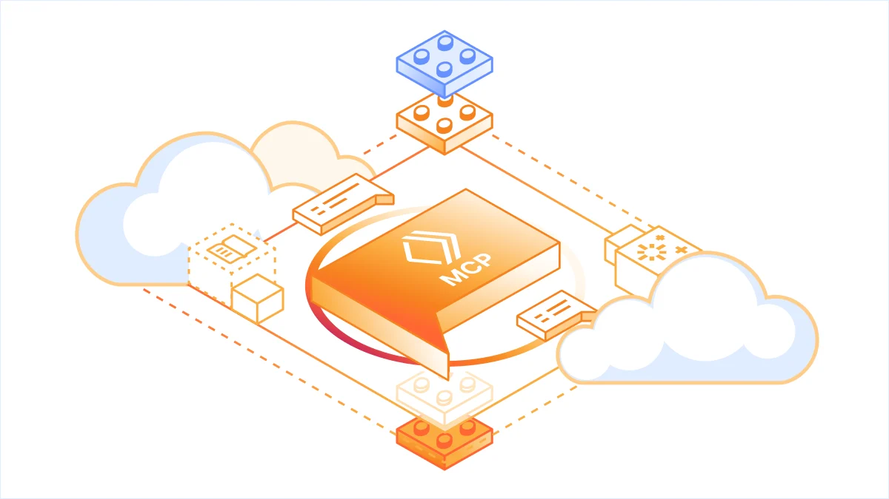
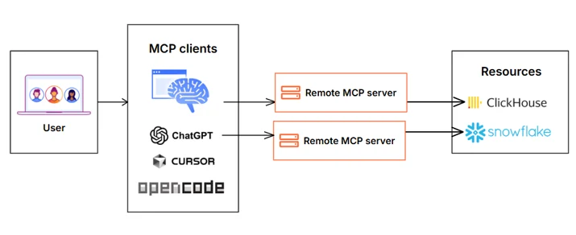
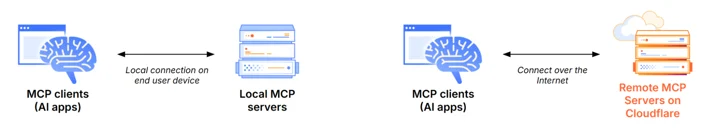
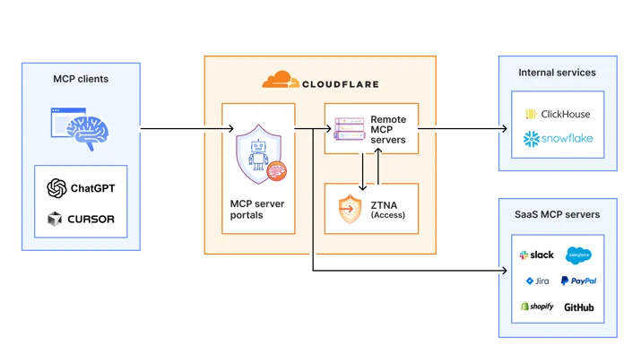
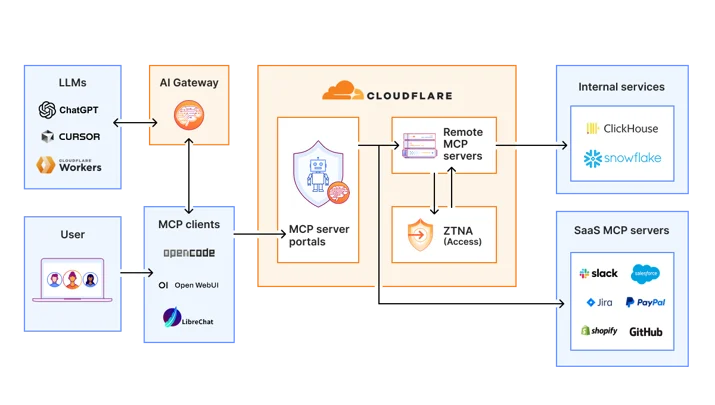

# 扩大 MCP 采用：我们面向更简单、更安全、更廉价的企业级 MCP 部署的参考架构

> 作者：Sharon Goldberg、Matt Carey（Cloudflare）
> 原文：<https://blog.cloudflare.com/enterprise-mcp/>（2026-04-14 发布，2026-07-15 更新）
> 英文原文：[Enterprise MCP en.md](./Enterprise%20MCP%20en.md)
> 抓取时间：2026-10-22
> 译文说明：`MCP server portal`、`Code Mode`、`Shadow MCP`、`DLP`、`AI Gateway` 等产品名保留英文，代码与正则照录。



Cloudflare 一直激进地把 [Model Context Protocol (MCP)](https://modelcontextprotocol.io/) 作为我们 AI 战略的核心部分。这一转变早已超出工程组织，产品、销售、市场和财务团队的员工现在都在用 agentic 工作流提升日常任务效率。但把 agentic 工作流与 MCP 结合，并非没有[安全风险](https://www.cloudflare.com/learning/ai/what-is-ai-security/)：从授权蔓延（authorization sprawl）、[prompt injection](https://www.cloudflare.com/learning/ai/prompt-injection/)，到[供应链风险](https://www.cloudflare.com/learning/security/what-is-a-supply-chain-attack/)。为了保障这种全公司范围的广泛采用，我们整合了 [Cloudflare One（SASE）平台](https://www.cloudflare.com/sase/)和 [Cloudflare 开发者平台](https://workers.cloudflare.com/)的一系列安全控制，让我们能在不拖慢员工的前提下治理 MCP 的 AI 使用。

本文将梳理我们保障 MCP 工作流安全的实践：把平台的不同部分组合起来，为自主 AI 时代构建统一的安全架构。我们还会分享两个支持企业级 MCP 部署的新概念：

- 我们推出 [Code Mode 与 MCP server portals](https://developers.cloudflare.com/cloudflare-one/access-controls/ai-controls/mcp-portals/#code-mode)，大幅降低 MCP 使用相关的 token 成本；
- 我们说明如何用 [Cloudflare Gateway](https://developers.cloudflare.com/cloudflare-wan/zero-trust/cloudflare-gateway/) 做 Shadow MCP 检测，发现对未授权远程 MCP server 的使用。

我们也会谈到组织内部是如何推进 MCP 部署的，以及如何用 Cloudflare 产品搭建 MCP 安全架构，包括[远程 MCP server](https://developers.cloudflare.com/agents/guides/remote-mcp-server/)、[Cloudflare Access](https://www.cloudflare.com/sase/products/access/)、[MCP server portals](https://developers.cloudflare.com/cloudflare-one/access-controls/ai-controls/mcp-portals/) 和 [AI Gateway](https://www.cloudflare.com/developer-platform/ai-gateway/)。

## 远程 MCP server 提供更好的可见性与控制

[MCP](https://www.cloudflare.com/learning/ai/what-is-model-context-protocol-mcp/) 是一个开放标准，让开发者能在 AI 应用与其需要访问的数据源之间建立双向连接。在这个架构里，MCP client 是与 [LLM](https://www.cloudflare.com/learning/ai/what-is-large-language-model/) 或其他 [AI agent](https://www.cloudflare.com/learning/ai/what-is-agentic-ai/) 的集成点，MCP server 位于 MCP client 与企业资源之间。



MCP client 与 MCP server 的分离，让 agent 能自主追求目标、采取行动，同时在 AI（集成在 MCP client）与企业资源的凭证和 API（集成在 MCP server）之间维持清晰边界。

Cloudflare 的员工不断使用 MCP server 访问各种内部资源，包括项目管理平台、内部 wiki、文档和代码管理平台等。

很早我们就意识到，本地托管的 MCP server 是一个安全负债。本地 MCP server 部署可能依赖未经审查的软件来源和版本，从而提高[供应链攻击](https://owasp.org/www-project-mcp-top-10/2025/MCP04-2025%E2%80%93Software-Supply-Chain-Attacks&Dependency-Tampering)或[工具注入攻击](https://owasp.org/www-community/attacks/MCP_Tool_Poisoning)的风险。它们让 IT 和安全管理员无法管理这些 server，只能由员工和开发者各自决定跑哪些 MCP server、怎么保持更新。这是一场必输的游戏。



相反，Cloudflare 有一个集中团队负责全企业的 MCP server 部署。这个团队在我们的 monorepo 内建了一个共享 MCP 平台，开箱即提供受治理的基础设施。当员工想通过 MCP 暴露某个内部资源时，先拿到我们 AI 治理团队的批准，然后复制模板、写工具定义、部署，同时免费继承默认拒绝的写控制（带审计日志）、自动生成的 [CI/CD 流水线](https://www.cloudflare.com/learning/serverless/glossary/what-is-ci-cd/)和[密钥管理](https://www.cloudflare.com/learning/security/glossary/secrets-management/)。这意味着起一个受治理的新 MCP server 只需几分钟脚手架。治理被烘进平台本身，这正是采用能迅速铺开的原因。

我们的 CI/CD 流水线把它们作为[远程 MCP server](https://developers.cloudflare.com/agents/guides/remote-mcp-server/)部署到 [Cloudflare 开发者平台](https://www.cloudflare.com/developer-platform/)上的自定义域名。这让我们能看清员工在用哪些 MCP server，同时保持对软件来源的控制。额外的好处是：Cloudflare 开发者平台上的每个远程 MCP server 都会自动部署到我们全球的数据中心网络，所以无论员工身在何处，都能低延迟访问。

### Cloudflare Access 提供认证

有些 MCP server 面向公开资源，比如我们的 [Cloudflare 文档 MCP server](https://docs.mcp.cloudflare.com/mcp) 或 [Cloudflare Radar MCP server](https://radar.mcp.cloudflare.com/mcp)，我们希望任何人都能访问。但员工使用的许多 MCP server 面向私有企业资源。这些 MCP server 需要用户认证，确保除授权 Cloudflare 员工外一律不可访问。为此，我们的 MCP server monorepo 模板集成了 [Cloudflare Access](https://www.cloudflare.com/sase/products/access/) 作为 OAuth provider。Cloudflare Access 保障登录流程、向资源签发访问 token，同时充当身份聚合器，校验终端用户的[单点登录（SSO）](https://www.cloudflare.com/learning/access-management/what-is-sso/)、[多因素认证（MFA）](https://www.cloudflare.com/learning/access-management/what-is-multi-factor-authentication/)，以及 IP 地址、位置、设备证书等多种上下文属性。

## MCP server portals 集中发现与治理



*MCP server portals 统一治理和控制所有 AI 活动。*

随着远程 MCP server 数量增长，我们撞上一堵新墙：发现。我们希望每位员工（尤其是 MCP 新手）都能轻松找到并使用所有对他们可用的 MCP server。我们的 MCP server portals 产品提供了便利的解法。员工只需把 MCP client 连到 MCP server portal，portal 立刻展示所有他有权使用的内部与第三方 MCP server。

除此之外，MCP server portals 还提供集中日志、一致的政策执行和[数据防泄漏](https://www.cloudflare.com/learning/access-management/what-is-dlp/)（DLP）护栏。管理员能看到谁登录了哪个 MCP portal，并创建 DLP 规则，阻止某些数据（如个人身份信息 PII）被共享给某些 MCP server。

我们还能创建策略，控制谁有权访问 portal 本身，以及每个 MCP server 的哪些工具应当暴露。例如，可以设一个只对 *finance* 组员工开放、且只暴露内部代码仓库 MCP server 只读工具的 portal；另一个只对 *engineering* 团队、使用公司笔记本的员工开放，暴露该代码仓库 MCP server 更强的读写工具。

portal 同时支持托管在 Cloudflare 上的远程 MCP server，以及托管在任何地方的第三方 MCP server。这个架构性能独特的来源是：所有这些安全与网络组件都跑在全球网络中的同一台物理机器上。当员工请求穿过 MCP server portal、Cloudflare 托管的远程 MCP server 和 Cloudflare Access 时，流量从不需要离开同一台物理机器。

## Code Mode 配合 MCP server portals 降低成本

经过数月高强度的 MCP 部署，我们已经付出了相当可观的 token 账单。我们也开始认为，大多数人在 MCP 上的做法是错的。

MCP 的标准做法要求为 MCP server 暴露的每个 API 操作定义一个独立工具。但这种静态、穷举的方式会迅速耗尽 agent 的上下文窗口，对于有成千上万个端点的大型平台尤其如此。

我们之前写过如何用服务端 [Code Mode 驱动 Cloudflare 的 MCP server](https://blog.cloudflare.com/code-mode-mcp/)，在暴露 [Cloudflare API 的数千个端点](https://developers.cloudflare.com/api/)的同时把 token 用量降低 99.9%。Cloudflare MCP server 只暴露两个工具：`search` 工具让模型写 JavaScript 探索有什么可用，`execute` 工具让它写 JavaScript 调用找到的工具。模型按需发现所需内容，而不是一开始就收到全部。

我们太喜欢这个模式，所以必须让所有人都能用。于是我们现在推出了在 [MCP server portals](https://developers.cloudflare.com/cloudflare-one/access-controls/ai-controls/mcp-portals/) 上使用 "Code Mode" 模式的能力。现在你可以用集中式 portal 把全部 MCP server 前置，由它执行审计控制和渐进式工具披露，以降低 token 成本。

原理如下。不再把每个工具定义暴露给 client，你所有底层 MCP server 都坍缩成两个 portal 工具：`portal_codemode_search` 和 `portal_codemode_execute`。`search` 工具给模型一个 `codemode.tools()` 函数，返回所有已连接上游 MCP server 的工具定义。模型随后写 JavaScript 过滤、探索这些定义，精确找到它需要的工具，而不必把所有 schema 载入上下文。`execute` 工具提供一个 `codemode` 代理对象，每个上游工具都是可调用函数。模型写 JavaScript 直接调用它们，链式执行多个操作、过滤结果、在代码里处理错误。这一切都跑在由 [Dynamic Workers](https://developers.cloudflare.com/dynamic-workers/) 驱动的 MCP server portal 沙箱环境中。

下面是一个需要找到 Jira ticket 并用 Google Drive 信息更新它的 agent 示例。它先搜索正确的工具：

```javascript
// portal_codemode_search
async () => {
 const tools = await codemode.tools();
 return tools
  .filter(t => t.name.includes("jira") || t.name.includes("drive"))
  .map(t => ({ name: t.name, params: Object.keys(t.inputSchema.properties || {}) }));
}
```

模型现在知道了它需要的准确工具名和参数，而完整 schema 从未进入它的上下文。接着它写一次 `execute` 调用，把操作串起来：

```javascript
// portal_codemode_execute
async () => {
 const tickets = await codemode.jira_search_jira_with_jql({
  jql: 'project = BLOG AND status = "In Progress"',
  fields: ["summary", "description"]
 });
 const doc = await codemode.google_workspace_drive_get_content({
  fileId: "1aBcDeFgHiJk"
 });
 await codemode.jira_update_jira_ticket({
  issueKey: tickets[0].key,
  fields: { description: tickets[0].description + "\n\n" + doc.content }
 });
 return { updated: tickets[0].key };
}
```

只有两次工具调用。第一次发现有什么可用，第二次干活。没有 Code Mode，同一个工作流需要模型先收到两个 MCP server 全部工具的完整 schema，然后发起三次独立的工具调用。

看看省了多少：当我们的内部 MCP server portal 只连了四个内部 MCP server 时，它暴露 52 个工具，仅这些定义就消耗约 9,400 tokens 的上下文。开启 Code Mode 后，52 个工具坍缩为 2 个 portal 工具，约占 600 tokens，减少 94%。更关键的是，这个成本是固定的。随着我们给 portal 接入更多 MCP server，Code Mode 的 token 成本不会增长。

在 MCP server portal 上启用 Code Mode 只需给 URL 加一个查询参数。不用平时的 URL（如 `https://myportal.example.com/mcp`），而是加上 `?codemode=search_and_execute`（如 `https://myportal.example.com/mcp?codemode=search_and_execute`）。

## AI Gateway 提供可扩展性与成本控制

还没完。我们把 [AI Gateway](https://www.cloudflare.com/developer-platform/products/ai-gateway/) 放在 MCP client 与 LLM 之间的连接上，接入我们的架构。这让我们能快速切换不同 LLM provider（避免厂商锁定），并执行成本控制（限制每个员工能烧掉的 token 数）。完整架构如下图。



## Cloudflare Gateway 发现并阻断 shadow MCP

现在我们已经为授权 MCP server 提供了受治理的访问，接下来看看未授权的 MCP server。我们可以用 [Cloudflare Gateway](https://developers.cloudflare.com/cloudflare-wan/zero-trust/cloudflare-gateway/) 做 shadow MCP 发现。Cloudflare Gateway 是我们全面的安全 Web 网关，为企业安全团队提供对员工互联网流量的可见性与控制。

我们可以用 Cloudflare Gateway API 做多层扫描，找出未经 MCP server portal 访问的远程 MCP server。这可以用现有的多种 Gateway 与数据防泄漏（DLP）选择器实现，包括：

- 用 Gateway 的 `httpHost` 选择器扫描
  - 已知的 MCP server 主机名（如 [mcp.stripe.com](http://mcp.stripe.com)）
  - 用通配符主机名模式匹配 `mcp.*` 子域
- 用 Gateway 的 `httpRequestURI` 选择器扫描 MCP 特有的 URL 路径，如 `/mcp` 和 `/mcp/sse`
- 用基于 DLP 的 body 检查找出 MCP 流量，即使该流量的 URI 不含 `mcp` 或 `sse` 这种明显标记。具体来说，我们利用 MCP 使用 HTTP 上的 JSON-RPC 这一点：每个请求都含一个 `"method"` 字段，取值如 `"tools/call"`、`"prompts/get"` 或 `"initialize"`。下面是一些可用于在 HTTP body 中检测 MCP 流量的正则规则：

```javascript
const DLP_REGEX_PATTERNS = [
  {
    name: "MCP Initialize Method",
    regex: '"method"\\s{0,5}:\\s{0,5}"initialize"',
  },
  {
    name: "MCP Tools Call",
    regex: '"method"\\s{0,5}:\\s{0,5}"tools/call"',
  },
  {
    name: "MCP Tools List",
    regex: '"method"\\s{0,5}:\\s{0,5}"tools/list"',
  },
  {
    name: "MCP Resources Read",
    regex: '"method"\\s{0,5}:\\s{0,5}"resources/read"',
  },
  {
    name: "MCP Resources List",
    regex: '"method"\\s{0,5}:\\s{0,5}"resources/list"',
  },
  {
    name: "MCP Prompts List",
    regex: '"method"\\s{0,5}:\\s{0,5}"prompts/(list|get)"',
  },
  {
    name: "MCP Sampling Create Message",
    regex: '"method"\\s{0,5}:\\s{0,5}"sampling/createMessage"',
  },
  {
    name: "MCP Protocol Version",
    regex: '"protocolVersion"\\s{0,5}:\\s{0,5}"202[4-9]',
  },
  {
    name: "MCP Notifications Initialized",
    regex: '"method"\\s{0,5}:\\s{0,5}"notifications/initialized"',
  },
  {
    name: "MCP Roots List",
    regex: '"method"\\s{0,5}:\\s{0,5}"roots/list"',
  },
];
```

Gateway API 还支持更多自动化。例如，可以用上面定义的自定义 DLP profile 阻断流量、重定向，或者仅记录并检查 MCP payload。把这些拼起来，Gateway 就能对企业网络中访问的未授权远程 MCP server 提供全面检测。

更多搭建细节见这个[教程](https://developers.cloudflare.com/cloudflare-one/tutorials/detect-mcp-traffic-gateway-logs/)。

## 面向公众的 MCP server 用 AI Security for Apps 保护

到目前为止，我们关注的是保护员工对内部 MCP server 的访问。但和许多组织一样，我们也有面向公众的 MCP server，客户可以用它们以 agentic 方式管理和操作 Cloudflare 产品。这些 MCP server 托管在 Cloudflare 开发者平台上。（特定产品的 MCP 列表见[这里](https://developers.cloudflare.com/agents/model-context-protocol/mcp-servers-for-cloudflare/)，或者回看我们用 [Code Mode](https://blog.cloudflare.com/code-mode/) 更高效访问整个 Cloudflare API 的新方法。）

我们认为每个组织都应为自己的产品发布官方、第一方 MCP server。否则，你的客户就会从公共仓库获取未经审查的 server，这些包可能包含[危险的信任假设](https://www.docker.com/blog/mcp-horror-stories-the-supply-chain-attack/)、未披露的数据收集，以及各种未经许可的行为。发布自己的 MCP server，你就掌控了客户所用工具的代码、更新节奏和安全态势。

由于每个远程 MCP server 都是一个 HTTP 端点，我们可以把它放在 [Cloudflare Web 应用防火墙（WAF）](https://www.cloudflare.com/application-services/products/waf/)后面。客户可以在 WAF 内启用 [AI Security for Apps](https://developers.cloudflare.com/waf/detections/ai-security-for-apps/) 功能，自动检查入站 MCP 流量中的 prompt injection 尝试、敏感数据泄漏和主题分类。面向公众的 MCP 与任何其他 Web API 一样受到保护。

## 企业中 MCP 的未来

我们希望我们的经验、产品和参考架构，能帮助其他组织继续推进各自的企业级 MCP 广泛采用之路。

我们是这样保障自己的 MCP 工作流安全的：

- 为开发者提供模板化框架，用 Cloudflare Access 做认证，在开发者平台上构建并部署远程 MCP server
- 让全体员工连上 MCP server portals，确保对授权 MCP server 的安全、基于身份的访问
- 用 AI Gateway 中介员工 MCP client 背后的 LLM 访问以控制成本，并在 MCP server portals 中用 Code Mode 降低 token 消耗和上下文膨胀
- 用 Cloudflare Gateway [发现](https://developers.cloudflare.com/cloudflare-one/tutorials/detect-mcp-traffic-gateway-logs/) shadow MCP 使用

对于正在推进企业级 MCP 之旅的组织，我们建议先从把现有远程和第三方 MCP server 放到 [Cloudflare MCP server portals](https://developers.cloudflare.com/cloudflare-one/access-controls/ai-controls/mcp-portals/) 后面、并启用 Code Mode 开始，从而受益于更便宜、更安全、更简单的企业级 MCP 部署。

<sub>*致谢：这份参考架构与博客体现了 Cloudflare 内许多不同角色和业务单元的人的工作。以下只是部分贡献者：Ann Ming Samborski、Kate Reznykova、Mike Nomitch、James Royal、Liam Reese、Yumna Moazzam、Simon Thorpe、Rian van der Merwe、Rajesh Bhatia、Ayush Thakur、Gonzalo Chavarri、Maddy Onyehara 和 Haley Campbell。*</sub>
