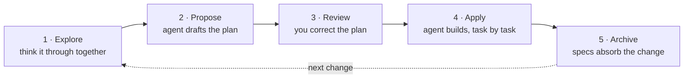

# OpenSpec — A Lightweight Spec Framework for Coding Agents

> 来源：<https://openspec.dev/>（官网）与 <https://openspec.dev/docs>（官方文档）
> 仓库：<https://github.com/Fission-AI/OpenSpec>（MIT，v1.14.2，72.1k stars）
> 抓取时间：2026-10-22
> 说明：本文按官网首页与 Quickstart / Setup / Profiles / Customize / spec-driven schema 等文档页整理，代码与命令均照录。

## What it is

> **The spec framework for *building the right thing* and *building it right***

OpenSpec is a lightweight and configurable framework for creating and managing software specifications. With OpenSpec, you capture what you want to build in a spec and keep your team and coding agents aligned as the work evolves. We help you refine the requirements, validate that they describe the right thing, and verify that the implementation matches.

In essence, OpenSpec helps you build the right thing and build it right.

By the numbers (site, 2026-10): **72.1k** GitHub stars, one new spec created **every two seconds**, used by more than **265,000 developers a month**, MIT licensed.

## Philosophy

```text
→ fluid not rigid
→ iterative not waterfall
→ easy not complex
→ built for brownfield not just greenfield
→ scalable from personal projects to enterprises
```

## Why teams adopt it

AI coding assistants are powerful but unpredictable when requirements live only in chat history. OpenSpec adds a lightweight spec layer so you agree on what to build before any code is written.

- **Agree before you build** — human and AI align on specs before code gets written
- **Stay organized** — each change gets its own folder with proposal, specs, design, and tasks
- **Work fluidly** — update any artifact anytime, no rigid phase gates
- **Use your tools** — works with 30+ AI assistants via slash commands

How it compares:

| Against | Trade-off |
|---|---|
| [Spec Kit](https://github.com/github/spec-kit) (GitHub) | Thorough but heavyweight: rigid phase gates, lots of Markdown, Python setup. OpenSpec is lighter and lets you iterate freely. |
| [Kiro](https://kiro.dev) (AWS) | Powerful but locks you into their IDE and Claude models. OpenSpec works with the tools you already use. |
| Doing nothing | Vague prompts and unpredictable results. OpenSpec brings predictability without the ceremony. |

## Installation

Requires **Node.js 20.19.0 or newer** (`node --version`). Install globally:

```bash
npm install -g @fission-ai/openspec@latest
# or
brew install openspec
```

Verify with `openspec --version`. Alternative install paths: Deno (`deno install --global ...`), Nix (`nix profile install github:Fission-AI/OpenSpec`), bun/pnpm (the CLI still needs Node on PATH). Update the CLI with `npm install -g @fission-ai/openspec@latest` (or `brew upgrade openspec`), then run `openspec update` **inside each project** to refresh generated skills and commands — they never update on their own.

You can also let an agent install it: paste `Fetch https://raw.githubusercontent.com/Fission-AI/OpenSpec/main/install.md and follow it.` into your AI chat.

## Setup

```bash
cd your-project
openspec init
```

Init asks which AI tools you use, writes workflow files for the ones you picked, and reports what you got:

```text
OpenSpec Setup Complete

Created: Claude Code
6 skills and 6 commands in .claude/
Config: openspec/config.yaml (schema: spec-driven)
```

Re-running init is safe: existing tools print `Refreshed`, adding a new tool adds it, and `--tools` skips the picker. Restart your IDE for the commands to take effect.

Init creates two things:

```text
openspec/
├── config.yaml     project settings and context for the AI
├── specs/          your specs (empty for now)
└── changes/        in-motion changes (empty for now)
    └── archive/    completed changes move here
```

and workflow files in your tool's folder (`.agents/`, `.claude/`, …):

```text
.agents/skills/
├── openspec-explore/              think through an idea first
├── openspec-propose/              propose a change
├── openspec-apply-change/         implement a change's tasks
├── openspec-update-change/        revise a change's plan
├── openspec-sync-specs/           sync a change's spec updates into specs/
├── openspec-archive-change/       move a finished change to the archive
├── openspec-verify-change/        check the implementation matches the plan (not included by default)
└── openspec-bulk-archive-change/  archive several changes at once (not included by default)
```

By default each workflow installs in two forms: a **skill** (`openspec-apply-change`), which the agent picks up on its own, and a **command** (`/opsx:apply` in Claude Code), a typed entry point with the same instructions. Some tools install in skill form only. The project prefers skills and expects to retire commands eventually.

## The workflow

Every change moves through the same five steps: you think the idea through with your agent, it drafts a plan, you correct the plan before any code exists, the agent builds from it, and archiving updates your specs with what shipped.



Site summary of the slash-command surface:

```text
/opsx:explore    map the problem and understand the codebase
/opsx:propose    draft proposal.md, specs/, design.md, tasks.md
/opsx:apply      implement tasks from the specification
/opsx:verify     check the implementation matches the spec
/opsx:archive    archive completed changes
```

### Step 1: Explore

Explore is a thinking mode. The agent investigates your codebase, asks the questions that matter, sketches options, and challenges assumptions. It never writes code. The output is a sharper idea.

```text
Help me explore how rate limiting should work in this app.
```

When the shape feels right, hand it off with `Propose the change we just discussed.`

### Step 2: Propose

Propose turns the idea into a reviewable plan and stops there — no code yet.

```text
Propose a change to add rate limiting.
```

```text
openspec/changes/add-rate-limiting/
├── proposal.md    why, and what changes
├── specs/         what "done" means, as testable requirements
├── design.md      technical decisions (only when the change needs one)
└── tasks.md       the implementation checklist
```

### Step 3: Review and correct the plan

Fix the plan while it is still words. Read in this order:

- **`proposal.md`**: is this the right problem, at the right size?
- **`specs/`**: the highest-value read. Would you accept these requirements as done?
- **`tasks.md`**: do the tasks cover the specs, and nothing more?

Either edit the Markdown files yourself, or tell the agent what's wrong ("the spec is missing the unauthenticated case").

### Step 4: Apply

Start a fresh chat session, since implementation goes better on a clean context window.

```text
Apply the add-rate-limiting change.
```

The agent works through `tasks.md`, checking off each task as it lands. Interrupted or out of context? Re-ask in a new session; it resumes at the first unchecked task. Progress lives in the checkboxes — there is no hidden state.

### Step 5: Archive

Archiving updates the main specs with the change's requirements and moves the change folder into `openspec/changes/archive/` with a date prefix. Nothing is deleted.

```text
Archive the add-rate-limiting change.
```

```text
# before
openspec/
├── specs/                                   (no rate-limiting spec yet)
└── changes/add-rate-limiting/{proposal.md,tasks.md,specs/rate-limiting/spec.md}

# after
openspec/
├── specs/rate-limiting/spec.md              the spec as built
└── changes/archive/2026-08-08-add-rate-limiting/...
```

`changes/` is clear for the next change; `specs/` is the source of truth for what the system does; `archive/` is the history of how it got there. Git stays a separate concern: commit the change folder with the code.

## Artifacts of the default `spec-driven` schema

| Artifact | File | Purpose |
|---|---|---|
| `proposal` | `proposal.md` | Why the change is needed |
| `specs` | `specs/<capability-path>/spec.md`, one per capability | What behavior changes |
| `design` | `design.md` | How to build it |
| `tasks` | `tasks.md` | The implementation checklist |

Drafting order:

```text
             ┌─ specs ──┐
proposal ────┤          ├── tasks ── apply
             └─ design ─┘
```

Proposal comes first. Specs and design follow in either order; tasks needs both. `design` is skipped when none of its conditions apply (cross-cutting change, new dependency or data model change, security/performance/migration complexity, ambiguity worth resolving before coding). `specs` is skipped only via `skip_specs: true` in the change's `.openspec.yaml` — and `openspec validate` rejects a zero-delta change without that marker, so don't invent a requirement to satisfy validation.

A spec is a behavior contract, not an implementation plan. Observable behavior, inputs/outputs, error conditions, external constraints, testable scenarios — no internal class names, library choices, or step-by-step implementation. Quick test: *if the implementation can change without changing externally visible behavior, it likely does not belong in the spec.*

Delta spec shape:

```markdown
# Spec Delta

## Purpose
<!-- New capabilities only: one or two sentences on what this capability is for. -->

## ADDED Requirements

### Requirement: User can export data
The system SHALL allow users to export their data in CSV format.

#### Scenario: Successful export
- **WHEN** user clicks "Export" button
- **THEN** system downloads a CSV file with all user data
```

Delta operations are `## ADDED Requirements`, `## MODIFIED Requirements` (full updated content, header matching the original exactly), `## REMOVED Requirements` (with **Reason** and **Migration**), and `## RENAMED Requirements` (FROM:/TO:). Use SHALL/MUST for normative requirements; every requirement needs at least one scenario; scenarios use exactly four hashtags (`####`) — three or bullets fail silently.

`tasks.md` is parsed for progress: a box holding only `x` counts as done; every other marker (`- [~]`, `- [-]`, `- []`) reads as unfinished. Each task must state how to verify completion, and each task group must land the tests and docs its own work calls for — do not collect testing into a final group, or failures cascade back through every group in between.

## Profiles and customization

The default `core` profile installs six workflows covering the whole loop: `explore`, `propose`, `apply`, `update`, `sync`, `archive`. Six more are optional — `new`, `continue`, `ff` (create artifacts one at a time instead of all at once), `verify`, `bulk-archive`, `onboard`. Change the set with `openspec config profile`; any selection that isn't exactly the core six is saved as `custom`.

Delivery is separate from the workflow set: `both` (default), `skills`, or `commands`.

```bash
openspec config set delivery skills   # or: both, commands
```

Customization has two levels:

| Option | What it changes | Use it when |
|---|---|---|
| Profiles | Which workflows are installed, and whether as skills, commands, or both | You want additional workflows, or to remove ones you don't need |
| Project configuration (`config.yaml`) | Instructions injected into every workflow run: context, rules, operation guidance | You want changes planned your way, e.g. tasks always including Playwright tests |
| Schemas | What OpenSpec produces: artifacts, their order, templates | Changes should produce different planning files, sections, or formats |

Config only adds on top of the core workflow; it can add "tasks always include tests" but cannot drop `design.md` or rename a file. That's schema territory (`openspec schema fork`).

## Stores (beta)

For multi-repo setups, **Stores** put planning in a repo of its own — the same `openspec/` shape (specs and changes), shared by `git push` like anything else. One source of truth the whole team and every coding agent can read, across every repo.

- **Cross-repo features** — one change, one plan, even when the code lands in three repos.
- **Shared requirements** — a platform team owns the specs; product teams reference them read-only.
- **Plan before code** — capture the plan in the store now; the code repos catch up later.

## Usage notes

- **Model selection**: OpenSpec works best with high-reasoning models. The project recommends Codex 5.5 and Opus 4.7 for both planning and implementation.
- **Context hygiene**: OpenSpec benefits from a clean context window. Clear your context before starting implementation (this is exactly the "context tax" argument from the other week-2 reading).
- **Telemetry**: anonymous command-name and version stats only; no arguments, paths, content, or PII. Opt out with `openspec config set telemetry.enabled false`, `OPENSPEC_TELEMETRY=0`, or `DO_NOT_TRACK=1`.

## Supported tools

Claude Code, Codex, Cursor, GitHub Copilot, Gemini CLI, OpenCode, Amazon Q Developer, Antigravity, Auggie, IBM Bob, Shell, Cline, Command Code, CodeArts, CodeBuddy, Devin Desktop, ForgeCode, Continue, CoStrict, Crush, Factory Droid, Hermes Agent, iFlow, Junie, Kilo Code, Kimi Code, Kiro, Lingma, MiniMax Code, Mistral Vibe, Oh My Pi, Pi, SourceCraft, Qoder, Qwen Code, Rovo Dev CLI, Zoo Code, Trae, Zed Agent, ZCode, and 33 more.

`/opsx:propose` is the canonical name; your tool may spell it `/opsx-propose` (Cursor, GitHub Copilot), `@opsx-propose` (Amazon Q), or `$openspec-propose` (Codex). `openspec init` prints the right form for the tools you picked.

## Sources

- <https://openspec.dev/> — homepage, stats, workflow summary, compatibility list
- <https://openspec.dev/docs/installation> — install/update/uninstall
- <https://openspec.dev/docs/setup> — `openspec init`, folder layout, skills vs commands
- <https://openspec.dev/docs/quickstart> — the five-step loop in detail
- <https://openspec.dev/docs/profiles> — core set, optional workflows, delivery
- <https://openspec.dev/docs/customize> — profiles vs config vs schemas
- <https://openspec.dev/docs/schemas/spec-driven> — artifacts, templates, apply contract
- <https://github.com/Fission-AI/OpenSpec> — README, philosophy, comparisons, stores
