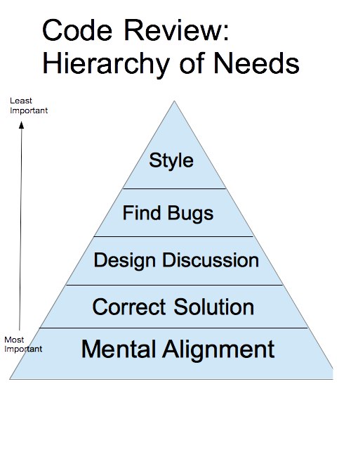
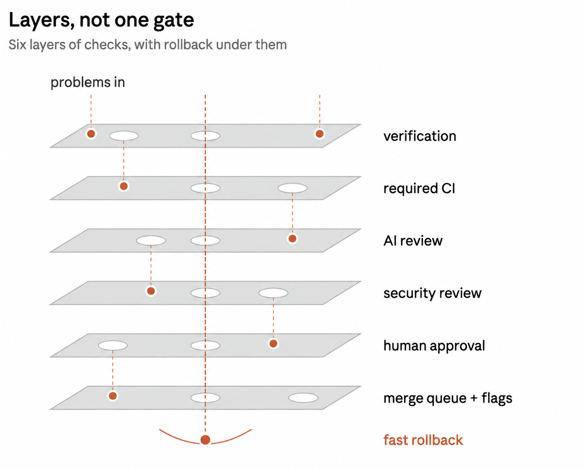
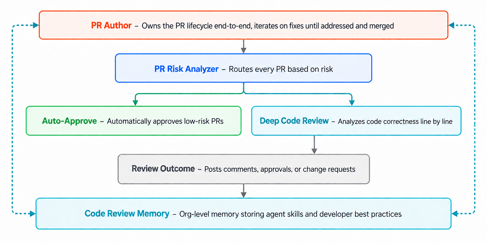
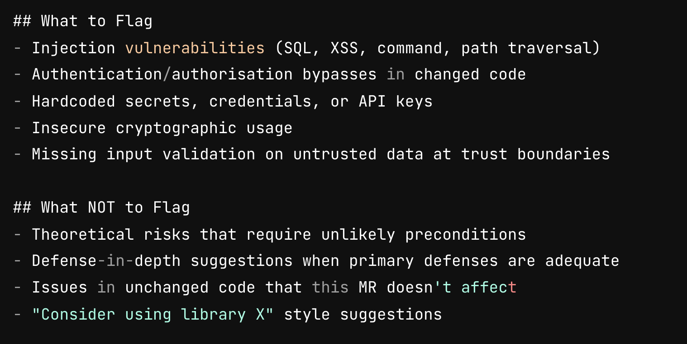
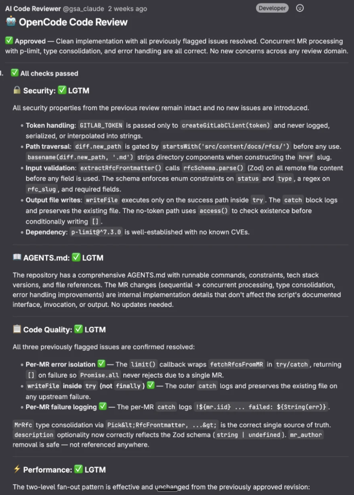
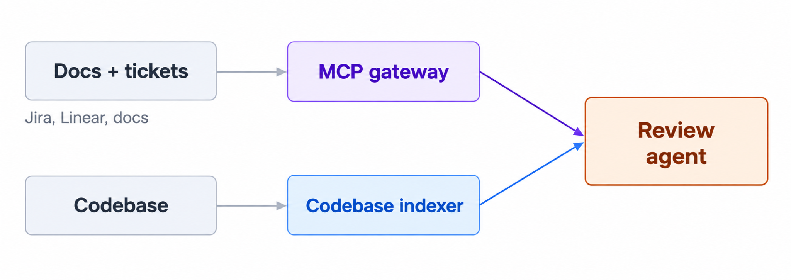

# 1027-agentic-code-review — slide transcript

> Unofficial English text extraction from the source `.pptx`, one section per slide, in presentation order.

> Source: [`1027-agentic-code-review en.pptx`](./1027-agentic-code-review%20en.pptx) · extracted 2026-10-29 · images in `images/1027/`

## Slide 1

- The Modern Software Developer
- CS146S
- Stanford University, Fall 2026
- Mihail Eric
- themodernsoftware.dev

## Slide 2

- Logistics
- Assignment 5 due Sunday
- Remaining credits (Grok, Cognition)
- Guest lecture - STLC 111 (all Thursday lectures moving forward)
- Silas Alberti, Chief Research Officer @ Cognition
- themodernsoftware.dev

## Slide 3

- Agentic Code Review
- themodernsoftware.dev

## Slide 4

- Why
- Software code review is one of the highest leverage activities you can do to become a better engineer and improve overall team code quality
- Detect and fix bugs
- Develop shared mental model in team
- themodernsoftware.dev

## Slide 5

- What review catches
- Logic and correctness errors
- Readability and maintainability
- Performance
- Security
- Best practices (tribal knowledge)
- themodernsoftware.dev

## Slide 6

- Source: Blake Smith
- themodernsoftware.dev

**Speaker notes:**

- Helps team members adapt their mental model of the system as it’s changing
- Ensures the change correctly solves the problem
- Opens discussion for strengths and weaknesses of a design
- Catches bugs before they get to production
- Keeps the code style and organization consistent

## Slide 7

- AI-Native Code Review
- Code review is the new bottleneck → hasn’t maintained pace with speed of code generation
- Maturity ladder
- Stage 0: human reviews everything
- Impossible to scale
- Stage 1: single agent review
- Better especially if combined with auto-fix loop but still leaves gains on the table
- Stage 2: multi-agent risk-tiered review with self-improvement built in
- Engineering code standards stored in skill knowledge base
- Best practice that many companies are converging on
- themodernsoftware.dev

## Slide 8

- themodernsoftware.dev

**Speaker notes:**

- https://x.com/addyosmani/status/2114604912520921136?s=43

## Slide 9

- themodernsoftware.dev

**Speaker notes:**

- https://www.augmentcode.com/blog/solving-code-review-with-cosmos

## Slide 10

- AI-Native Code Review
- Security Review
- Architecture
- Review
- Pull request
- Aggregate Judge
- Code Quality
- Review
- Performance
- Review
- themodernsoftware.dev

**Speaker notes:**

- Multi-agent agent with a separate agent dedicated to different aspects of review
- https://blog.cloudflare.com/internal-ai-engineering-stack/

## Slide 11

- Text visible in the slide image (security reviewer prompt excerpt):
- ## What to Flag
- Injection vulnerabilities (SQL, XSS, command, path traversal)
- Authentication/authorisation bypasses in changed code
- Hardcoded secrets, credentials, or API keys
- Insecure cryptographic usage
- Missing input validation on untrusted data at trust boundaries
- ## What NOT to Flag
- Theoretical risks that require unlikely preconditions
- Defense-in-depth suggestions when primary defenses are adequate
- Issues in unchanged code that this MR doesn't affect
- "Consider using library X" style suggestions
- themodernsoftware.dev

**Speaker notes:**

- Security review agent

## Slide 12

- AI-Native Code Review

- themodernsoftware.dev

**Speaker notes:**

- Multi-agent agent with a separate agent dedicated to different aspects of review
- https://blog.cloudflare.com/internal-ai-engineering-stack/

## Slide 13

- Design of an agentic code reviewer
- Diversify model used for review compared to generation
- Model inverter
- Thoughtful context

- themodernsoftware.dev

**Speaker notes:**

- https://www.greptile.com/blog/how-to-build-a-code-review-agent

## Slide 14

- Design of an agentic code reviewer
- Verify
- Spin up dev container to test different code flows
- Cost efficiency
- Pick model based on task complexity
- Code context → cheap/fast model
- Browser use → smaller/medium model, higher reasoning
- Deep bug analysis → frontier model
- Evaluations
- Historical PRs with known bugs
- Detected incidents with reverts
- themodernsoftware.dev

## Slide 15

- Options
- General purpose
- Claude Code
- Greptile
- Coderabbit
- Devin
- Security
- Vercel deepsec
- Wiz security
- Semgrep
- themodernsoftware.dev

## Slide 16

- Questions?
- themodernsoftware.dev
